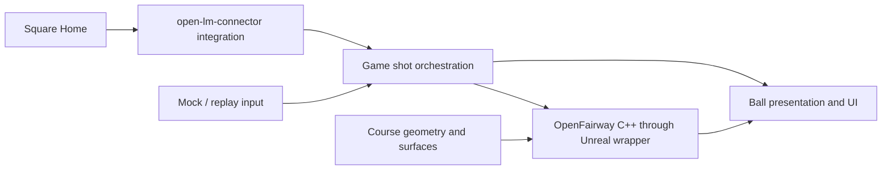

# Architecture

## Current foundation

The game module is `UOpenGolf`. Its C++ GameMode runs range mode: it spawns a
range (`AUOpenGolfRange`, built at runtime) and a game-side `AUOpenGolfBall`
subclass of the OpenFairway ball on the tee, and hits every launch-monitor shot from the tee. Three
seconds after the ball stops, the GameMode puts it back on the tee; the ball keeps
its last shot result until the next launch. The HUD
adds a Slate widget (`SRangeHud`) with shot tiles and a launch-monitor status box; the player controller
binds keys (C connect, D disconnect, R replay shot, Tab next club, T tee up) and runs
the shot camera. There is no pawn, course or scoring. `UOpenGolf`
is an original blank Unreal map used for editor and game startup.

The calibration range assigns `OpenFairway.Surface.Fairway` and fairway appearance
to every ground mesh, including the former green/fringe area and side strips.
These are scene assignments: the ball still resolves contact tags normally, and
the physics plugin retains its other surface presets. No replay-specific surface
override is used.

The game owns the imported CC0 grass textures, golf ball and flagstick under
`Content/UOpenGolf/Art/` (see [asset provenance](RangeAssets.md)). The ball subclass
only replaces the protected visual mesh, normalized to the base actor's 100 cm
source diameter. Ground collision stays on the basic shapes. Decorative grass
uses collision-free hierarchical instances near the tee; `uopengolf.Grass3D`
clears or recreates those instances at runtime. The physics plugin has no
dependency on these assets or on the game module.

The `OpenLaunchMonitor` runtime plugin is the launch-monitor adapter:

| Layer | Location (`Plugins/OpenLaunchMonitor/Source/OpenLaunchMonitor/`) | Notes |
| --- | --- | --- |
| Game boundary | `Public/OpenLaunchMonitorSubsystem.h`, `Public/LaunchMonitorTypes.h` | Game-instance subsystem; Blueprint and C++ events for state, ball ready, battery, shots, club data and errors; replay input |
| Square session | `Private/Square/SquareSession.*` | Game-thread state machine: scan, handshake, heartbeat, arming, duplicate filtering, late club data, link loss |
| Square protocol | `Private/Square/SquareProtocol.*` | Frame decoding and commands; depends only on Core (and Json for firmware text) |
| Transport | `Private/Bluetooth/GattTransport.h`, `Private/Windows/` | Bluetooth LE GATT interface; C++/WinRT on Windows, not yet on Linux |

See [launch-monitor integration](LaunchMonitorIntegration.md) for its contracts.

The `OpenFairwayPhysics` runtime plugin is the physics core and its Unreal wrapper:

| Layer | Location (`Plugins/OpenFairwayPhysics/Source/OpenFairwayPhysics/`) | Notes |
| --- | --- | --- |
| OpenFairway core | `Public/OpenFairway/`, `Private/OpenFairway/` | Flight, impact, ground and rest equations, surfaces, ball profile and launch regimes, headless `ShotSimulator`; depends only on Core, SI units in its own right-handed frame |
| Unreal wrapper | `Public/OpenFairwayBall.h`, `Public/OpenFairwayTypes.h` | Ball actor stepping the core at 120 Hz; Chaos sphere sweeps and line traces for contacts; surface tags; Blueprint launch, results and events |

Chaos only answers contact queries; the ball never simulates as a Chaos rigid body, so
OpenFairway owns the motion. See the [plugin README](../Plugins/OpenFairwayPhysics/README.md).
The two plugins do not depend on each other; the game module converts shots to launches.

Game and editor targets use UnrealBuildTool's standard C# configuration files.
Gameplay remains native C++. Python is used only by developer utilities.

## Future boundaries

| Component | Owns | Must remain separate from |
| --- | --- | --- |
| Game/session layer | Shot orchestration, measured shot records, sessions, UI and Blueprint events | Device protocol details and numerical integration |
| Launch-monitor adapter | `open-lm-connector` integration, connection state, device configuration, measured ball and optional club data | Course rules and physics tuning |
| OpenFairway C++ core | Flight, spin, impact, roll and rest calculations | Unreal worlds, rendering, device transports and UI |
| Unreal physics wrapper | Scheduling, collision/contact queries, native core adaptation, Blueprint controls/events | Monitor-specific packets |
| Course/surface layer | Geometry, collision, lies, contact surface resolution and green configuration | Duplicate impact/rollout formulas |
| Presentation/content | Ball visuals, HUD, camera and optional content packs | Authoritative simulation calculations |

These are architectural responsibilities, not frozen APIs. The launch-monitor
adapter, OpenFairway core and Unreal physics wrapper now exist as the two plugins
above; the game/session layer is the range mode in `UOpenGolf`. The course/surface
layer is only the whitebox range and surface tags so far.

Every node exists in a first form: replay is built in, physics is the OpenFairway
plugin, course geometry is the whitebox range with tagged surfaces, and presentation
is the ball, tracer, shot camera and Slate HUD (shot tiles and launch-monitor status box).

## Reference projects

- `open-lm-connector`: Godot-facing C# entry points wrap Square session/protocol code
  and Bluetooth abstractions. Windows uses WinRT; Linux uses BlueZ. Its protocol,
  session and Windows transport were ported natively to C++ from a pinned revision;
  no .NET runtime or bridge process is used.
- `ogolf-physics`: the maintained C# golf physics (a successor of `openfairway`'s
  addon) with a Godot-free core and calibration data. Its core, profiles, surfaces and
  headless shot loop were ported to C++ from revision `e6d793a`; golden fixtures come
  from its C# sources through an optional .NET harness.
- `openfairway`: the earlier C# physics; superseded by `ogolf-physics` and not ported.
- `ogolf`: reference for contour/height data shared by rendering and collision, lie
  mapping, and resolving surfaces at actual contact points. Physics calculations
  belong to OpenFairway.

Current physics defaults add speed-dependent flight spin decay and continuous
interpolation of calibration scales and landing responses. The explicit
`HistoricalReference()` profile preserves the pinned C# behavior for golden tests;
parity with that profile is not independent physical validation. See the
[FlightScope analysis](FlightScopeAnalysis.md) for the changes and measurements.

The sibling repositories are not required, modified, or linked by the build. The
connector port is described in [launch-monitor integration](LaunchMonitorIntegration.md);
the physics port in the [OpenFairway Physics README](../Plugins/OpenFairwayPhysics/README.md).

## Contracts to establish in Phase 1

Launch-monitor contracts are recorded in
[launch-monitor integration](LaunchMonitorIntegration.md). The physics-side contracts
below are recorded in the [OpenFairway Physics README](../Plugins/OpenFairwayPhysics/README.md):
units and frames, the 120 Hz fixed step owned by the ball actor, game-thread only
execution, and 21 golden fixtures with their tolerances.

Document measured-shot units and optional values, axis/handedness and spin signs,
Unreal centimeters versus physics units, timing and fixed-step ownership, thread
handoff, connection lifecycle, and shot/club-data association. Preserve measured
input independently of any game-side lie adjustment. Define baseline fixtures and
comparison tolerances before porting the simulation.

Resolve these from the actual upstream revisions and platform feasibility work;
do not create speculative public structs or transports in the UOpenGolf module.

## Windows and Linux

Both are intended supported targets. Shared game and physics code must stay portable;
Bluetooth/platform dependencies belong behind the connector boundary. Case-correct
paths, explicit engine locations, and equivalent Bash/PowerShell workflows are required.
Mock and replay input will enable hardware-free community development.

Track actual validation independently for each OS in the README. A Windows build
does not establish Linux compiler, rendering, Bluetooth, or packaged-game behavior.

## Content boundary

Public maps/defaults must reference only distributable project content or separately
installed engine resources. Optional restricted content lives in private content
plugins under ignored `Plugins/PrivateContent/`, with private maps owning those
references. The public baseline must open, compile, and run when that directory is absent.

The game mode's editable `RangeClass` defaults to the native range. Private maps
can select a Blueprint game-mode subclass whose range subclass supplies grass
mesh variants, a ground material and scatter settings. C++ applies those settings
at startup and retains ownership of grass toggling and all gameplay. See
[optional range visuals](OptionalRange.md) for the content boundary and verification.
