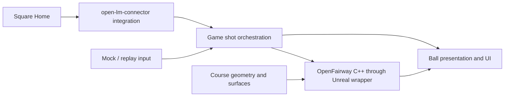

# Architecture

## Current foundation

The game module is `UOpenGolf`. Its C++ GameMode selects a C++ HUD and player
controller. The HUD draws the greeting and a launch-monitor status panel; the
controller binds test keys (C connect, X disconnect, R replay shot, Tab next club).
There is no pawn, simulation, course geometry, or imported content. `HelloWorld` is
an original blank Unreal map used for editor and game startup.

The `OpenLaunchMonitor` runtime plugin is the launch-monitor adapter:

| Layer | Location (`Plugins/OpenLaunchMonitor/Source/OpenLaunchMonitor/`) | Notes |
| --- | --- | --- |
| Game boundary | `Public/OpenLaunchMonitorSubsystem.h`, `Public/LaunchMonitorTypes.h` | Game-instance subsystem; Blueprint and C++ events for state, ball ready, battery, shots, club data and errors; replay input |
| Square session | `Private/Square/SquareSession.*` | Game-thread state machine: scan, handshake, heartbeat, arming, duplicate filtering, late club data, link loss |
| Square protocol | `Private/Square/SquareProtocol.*` | Frame decoding and commands; depends only on Core (and Json for firmware text) |
| Transport | `Private/Bluetooth/GattTransport.h`, `Private/Windows/` | Bluetooth LE GATT interface; C++/WinRT on Windows, not yet on Linux |

See [launch-monitor integration](LaunchMonitorIntegration.md) for its contracts.

Game and editor targets use UnrealBuildTool's standard C# configuration files.
Gameplay remains native C++. Python is used only by developer utilities.

## Future boundaries

| Component | Owns | Must remain separate from |
| --- | --- | --- |
| Game/session layer | Shot orchestration, measured shot records, sessions, UI and Blueprint events | Device protocol details and numerical integration |
| Launch-monitor adapter | `open-lm-connector` integration, connection state, device configuration, measured ball and optional club data | Course rules and physics tuning |
| OpenFairway C++ core | Flight, spin, impact, roll and rest calculations | Unreal worlds, rendering, device transports and UI |
| Unreal physics wrapper | Scheduling, collision/contact queries, native core adaptation, Blueprint controls/events | Monitor-specific packets |
| Course/surface layer | Geometry, collision, lies, contact surface resolution and green configuration | Duplicate impact/rollout formulas |
| Presentation/content | Ball visuals, HUD, camera and optional content packs | Authoritative simulation calculations |

These are architectural responsibilities, not implemented modules or frozen APIs.
Create concrete plugins and types when their phase establishes the required contracts.
The intended physics plugin will contain a reusable C++ core and Unreal wrappers;
the connector's integration form is intentionally deferred to a feasibility review.

The connector, mock/replay input and presentation edges exist (replay is built in,
presentation is the HUD panel); physics and course nodes are planned.

## Reference projects

- `open-lm-connector`: Godot-facing C# entry points wrap Square session/protocol code
  and Bluetooth abstractions. Windows uses WinRT; Linux uses BlueZ. Its protocol,
  session and Windows transport were ported natively to C++ from a pinned revision;
  no .NET runtime or bridge process is used.
- `openfairway`: C# physics is the reference implementation. Some current classes
  depend on Godot types. Identify the numerical core and regression corpus before
  migration; retain upstream notices and pin the reference revision.
- `ogolf`: reference for contour/height data shared by rendering and collision, lie
  mapping, and resolving surfaces at actual contact points. Physics calculations
  belong to OpenFairway. Verify licensing before copying implementation or assets.

The sibling repositories are not required, modified, or linked by the build. Ported
connector code is recorded in the third-party notices.

## Contracts to establish in Phase 1

Launch-monitor contracts are now recorded in
[launch-monitor integration](LaunchMonitorIntegration.md). The remaining items are
the physics-side contracts below.

Document measured-shot units and optional values, axis/handedness and spin signs,
Unreal centimeters versus physics units, timing and fixed-step ownership, thread
handoff, connection lifecycle, and shot/club-data association. Preserve measured
input independently of any game-side lie adjustment. Define baseline fixtures and
comparison tolerances before porting the simulation.

Resolve these from the actual upstream revisions and platform feasibility work;
do not create speculative public structs or transports in the hello-world module.

## Windows and Linux

Both are intended supported targets. Shared game and physics code must stay portable;
Bluetooth/platform dependencies belong behind the connector boundary. Case-correct
paths, explicit engine locations, and equivalent Bash/PowerShell workflows are required.
Mock and replay input will enable hardware-free community development.

Track actual validation independently for each OS in the README. A Windows build
does not establish Linux compiler, rendering, Bluetooth, or packaged-game behavior.

## Content boundary

Public maps/defaults must reference only distributable project content or separately
installed engine resources. Optional restricted content lives in private content
plugins under ignored `Plugins/PrivateContent/`, with private maps owning those
references. The public baseline must open, compile, and run when that directory is absent.
