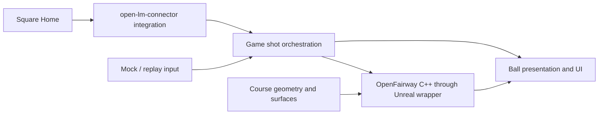

# Architecture

## Current foundation

The game module is `UOpenGolf`. Its C++ GameMode uses the map's saved range controller
(`AUOpenGolfRange`) and spawns a game-side `AUOpenGolfBall` on its tee. Ground, tee box,
flagstick and lighting are separate saved actors, selectable before Play. A blank legacy map
still builds the same layout at runtime. Multiple controllers are rejected to prevent duplicate
scenes. Every launch-monitor shot starts from the tee. Three
seconds after the ball stops, the GameMode puts it back on the tee; the ball keeps
its last shot result until the next launch. The HUD
adds a Slate widget (`SRangeHud`) with shot tiles and a launch-monitor status box; the player controller
binds keys (C connect, T disconnect, H replay shot, Tab next club, R tee up, A/D held
to turn the aim) and runs the shot camera along the ball's aim line. There is no pawn, course or scoring. `UOpenGolf`
is the saved range map used for editor and game startup, and the project's only map. A world
without a range controller gets one with daylight and a flag; the ground always comes from a
terrain area.

The top-center wind readout shows whole mph and an arrow pointing where wind blows relative
to the camera. Down means headwind, up means tailwind. It uses the ball's effective wind,
including the captured wind during a moving shot, and falls back to the range without a ball.
Open `/Game/UOpenGolf/UI/WBP_WindIndicator` in the Widget Blueprint Designer to preview
it before Play. Select its WindIndicator child and edit Wind Speed Mph, Wind From Deg and
View Yaw Deg to try directions. The default preview is 10 mph from the right. The saved
Canvas sets the top-center position; gameplay embeds this same asset in the Slate HUD.
The native `UOpenGolfWindIndicator` wraps `SWindIndicator`, sharing the drawing in both views.
The editor command `uopengolf.CreateWindIndicatorAsset` creates the asset only if missing.

A shot result includes `TerminationReason` (`None`, `Rest`, or `SafetyStop`). A safety stop
still ends motion and schedules a re-tee, but the HUD labels it interrupted and does not show
completed total/roll or invent a carry without landing. Recordings add the reason and use null
for unavailable completed distances; existing fields and normal shot behavior are retained.

Shot recording is a game-owned service, independent of Slate and the world. It tracks
measured shot IDs separately from simulation IDs, accepts club data after ball rest,
and closes the club-data window three seconds after receipt. Completed records use
same-directory temporary writes followed by a rename. Failed saves retain their
session and file index in memory and retry during Play, even after recording is
switched off; shutdown makes a final attempt. This queue does not recover across
Play sessions or application restarts. The HUD exposes its saved count and failures.

The range builds from the `OpenGolfCourse` plugin, the course/surface layer. A surface is
declared by the physical material on the terrain's surface meshes (`PM_Fairway`, `PM_Green`,
`PM_Sand`, `PM_Rough` and the other `UOpenFairwayPhysicalMaterial` assets), and the ball reads
the contact's physical material. Component or actor `OpenFairway.Surface.*` tags remain an
explicit override. No replay-specific surface override is used.

The course kit owns the CC0 grass textures, golf ball, waving flagstick and turf
materials, with editable Blender sources (see the
[OpenGolfCourse README](../Plugins/OpenGolfCourse/README.md)). The game keeps the tracer
material in `Content/UOpenGolf/Art/`. The ball subclass
normalizes the visual mesh's actual bounds to a 42.67 mm diameter and owns a
collision-free procedural ribbon with a translucent material. It samples the
simulated path and fades during rollout; launch/reset clears the ribbon. CPU buffers
are reused, topology is recreated only when sample count changes, and camera-facing
vertices update an existing section otherwise. Unchanged geometry, opacity and
visibility updates are skipped. The inherited debug tracer is disabled on the game ball. Ground collision comes from the terrain's
generated surface meshes and outer landscapes, which reach beyond the ball's 1,000 m safety envelope.
The terrain's 3D grass and ground cover are collision-free instances; `uopengolf.Grass3D` hides or
shows them at runtime. The physics plugin has no
dependency on these assets or on the game module; the course kit depends on the physics
plugin for the surface type, and the game depends on both.

The saved range exposes `WindSpeedMph`, `WindFromDeg` and `bPreviewWindInEditor` under
UOpenGolf → Wind in Details. Before Play, the range's wind drives the flag preview when
Realtime is enabled; it uses the default air density. During Play, authored settings
initialize the ball, and the range sends the ball's wind and air density to the cloth.
Changed `uopengolf.WindMph` and `uopengolf.WindFromDeg` commands update the Play-world
range controls. Console values left from a previous Play session do not replace the
map's settings on startup. A moving shot retains its launch environment, so the flag
keeps showing that wind until the shot ends. Default wind is zero.
`WindDirectionalSource` is not connected. See the
[wind validation steps](RangeAssets.md#validate-wind-and-flag-movement).

Green speed is the ball's `GreenStimpFeet` (8–15, default 10); during Play,
`uopengolf.GreenStimp` changes it from the next shot. OpenFairway solves the green's rolling
friction from the stimp together with the green's grass drag, so the range supplies only the
setting and no green formula. See
[Surfaces](../Plugins/OpenFairwayPhysics/README.md#surfaces).

The `OpenLaunchMonitor` runtime plugin is the launch-monitor adapter:

| Layer | Location (`Plugins/OpenLaunchMonitor/Source/OpenLaunchMonitor/`) | Notes |
| --- | --- | --- |
| Game boundary | `Public/OpenLaunchMonitorSubsystem.h`, `Public/LaunchMonitorTypes.h` | Game-instance subsystem; Blueprint and C++ events for state, ball ready, battery, shots, club data and errors; replay input |
| Square session | `Private/Square/SquareSession.*` | Game-thread state machine: scan, handshake, heartbeat, arming, duplicate filtering, late club data, link loss |
| Square protocol | `Private/Square/SquareProtocol.*` | Frame decoding and commands; depends only on Core (and Json for firmware text) |
| Transport | `Private/Bluetooth/GattTransport.h`, `Private/Windows/`, `Private/Linux/` | Bluetooth LE GATT interface; C++/WinRT on Windows, BlueZ over runtime-loaded sd-bus on Linux (`Private/Bluetooth/BlueZModel.*` holds its platform-neutral mapping logic) |

Both transports run every Bluetooth call on one worker thread and bound waits to ten
seconds per operation and thirty seconds for device opening/service discovery, checking
cancellation at most every 25 ms while waiting. Disconnect invalidates queued work and
old callbacks, and doesn't wait for the device to answer; shutdown cooperatively stops
the worker. Synchronous OS/driver cleanup is outside those wait limits. See [launch-monitor integration](LaunchMonitorIntegration.md) for contracts
and remaining hardware verification.

The `OpenFairwayPhysics` runtime plugin is the physics core and its Unreal wrapper:

| Layer | Location (`Plugins/OpenFairwayPhysics/Source/OpenFairwayPhysics/`) | Notes |
| --- | --- | --- |
| OpenFairway core | `Public/OpenFairway/`, `Private/OpenFairway/` | Flight, impact, ground and rest equations, surfaces, ball profile and launch regimes, headless `ShotSimulator`; depends only on Core, SI units in its own right-handed frame |
| Unreal wrapper | `Public/OpenFairwayBall.h`, `Public/OpenFairwayTypes.h`, `Public/OpenFairwayPhysicalMaterial.h` | Ball actor stepping the core at 120 Hz; Chaos sphere sweeps and line traces for contacts; surfaces from physical materials or tags; presentation-only visual roll; Blueprint launch, results and events |

Chaos only answers contact queries; the ball never simulates as a Chaos rigid body, so
OpenFairway owns the motion. See the [plugin README](../Plugins/OpenFairwayPhysics/README.md).
The launch-monitor and physics plugins do not depend on each other; the game module converts
shots to launches. The `OpenGolfCourse` plugin (course kit) depends only on the physics plugin.
The ball actor retains a 120 Hz fixed step and a twelve-step frame cap. Long stalls
discard excess catch-up time, so sustained frame rates below about 10 FPS slow
simulation relative to wall time. The game tests cover frame-rate/hitch equivalence;
rendered CPU measurements and their limits are recorded in
[phase status](PhasesStatus.md#reference-measurements).

Game and editor targets use UnrealBuildTool's standard C# configuration files.
Gameplay remains native C++. Python is used only by developer utilities.

## Future boundaries

| Component | Owns | Must remain separate from |
| --- | --- | --- |
| Game/session layer | Shot orchestration, measured shot records, sessions, UI and Blueprint events | Device protocol details and numerical integration |
| Launch-monitor adapter | `open-lm-connector` integration, connection state, device configuration, measured ball and optional club data | Course rules and physics tuning |
| OpenFairway C++ core | Flight, spin, impact, roll and rest calculations | Unreal worlds, rendering, device transports and UI |
| Unreal physics wrapper | Scheduling, collision/contact queries, native core adaptation, Blueprint controls/events | Monitor-specific packets |
| Course/surface layer | Geometry, collision, lies, contact surface resolution and green configuration | Duplicate impact/rollout formulas |
| Presentation/content | Ball visuals, HUD, camera and optional content packs | Authoritative simulation calculations |

These are architectural responsibilities, not frozen APIs. The launch-monitor
adapter, OpenFairway core and Unreal physics wrapper now exist as the two plugins
above; the game/session layer is the range mode in `UOpenGolf`. The course/surface
layer is the OpenGolfCourse plugin (surface materials, flagstick, ball, turf) and the
whitebox range built from it.

Every node exists in a first form: replay is built in, physics is the OpenFairway
plugin, course geometry is the whitebox range built from the OpenGolfCourse kit, and presentation
is the ball, tracer, shot camera and Slate HUD (shot tiles and launch-monitor status box).

## Reference projects

- `open-lm-connector`: Godot-facing C# entry points wrap Square session/protocol code
  and Bluetooth abstractions. Windows uses WinRT; Linux uses BlueZ. Its protocol,
  session and both transports were ported natively to C++ from pinned revisions;
  no .NET runtime or bridge process is used.
- `ogolf-physics`: the maintained C# golf physics (a successor of `openfairway`'s
  addon) with a Godot-free core and calibration data. Its core, profiles, surfaces and
  headless shot loop were ported to C++ from revision `e6d793a`; golden fixtures come
  from its C# sources through an optional .NET harness.
- `openfairway`: the earlier C# physics; superseded by `ogolf-physics` and not ported.
- `ogolf`: reference for contour/height data shared by rendering and collision, lie
  mapping, and resolving surfaces at actual contact points. Physics calculations
  belong to OpenFairway.

Current physics defaults add speed-dependent flight spin decay and continuous
interpolation of calibration scales and landing responses. The explicit
`HistoricalReference()` profile preserves the pinned C# behavior for golden tests;
parity with that profile is not independent physical validation. See the
[FlightScope analysis](FlightScopeAnalysis.md) for the changes and measurements.

The sibling repositories are not required, modified, or linked by the build. The
connector port is described in [launch-monitor integration](LaunchMonitorIntegration.md);
the physics port in the [OpenFairway Physics README](../Plugins/OpenFairwayPhysics/README.md).

## Contracts to establish in Phase 1

Launch-monitor contracts are recorded in
[launch-monitor integration](LaunchMonitorIntegration.md). The physics-side contracts
below are recorded in the [OpenFairway Physics README](../Plugins/OpenFairwayPhysics/README.md):
units and frames, the 120 Hz fixed step owned by the ball actor, game-thread only
execution, and 21 golden fixtures with their tolerances.

Document measured-shot units and optional values, axis/handedness and spin signs,
Unreal centimeters versus physics units, timing and fixed-step ownership, thread
handoff, connection lifecycle, and shot/club-data association. Preserve measured
input independently of any game-side lie adjustment. Define baseline fixtures and
comparison tolerances before porting the simulation.

Resolve these from the actual upstream revisions and platform feasibility work;
do not create speculative public structs or transports in the UOpenGolf module.

## Windows and Linux

Both are supported targets. Shared game and physics code must stay portable;
Bluetooth/platform dependencies belong behind the connector boundary. Case-correct
paths, explicit engine locations, and equivalent Bash/PowerShell workflows are required.
Mock and replay input will enable hardware-free community development.

Track actual validation independently for each OS in [phase status](PhasesStatus.md).
A build or test run on one OS does not establish compiler, rendering, Bluetooth or
packaged-game behavior on the other. `ue.sh package` / `ue.ps1 Package` give both a
package and start check from one command.

## Content boundary

Maps, code and defaults reference only distributable project content or engine resources.
Restricted packs are never committed.

The game mode's editable `RangeClass` defaults to the native range; a map's game-mode subclass can
choose a range subclass.
