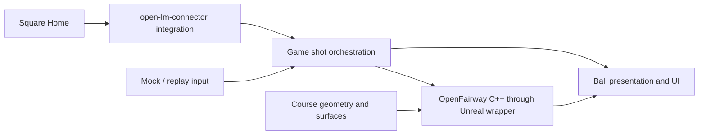

# Architecture

## Current foundation

The game module is `UOpenGolf`. Its C++ GameMode uses the map's saved range controller
(`AUOpenGolfRange`) and spawns a game-side `AUOpenGolfBall` on its tee. The terrain owns the ground. The flagstick and lighting are saved actors, selectable before Play. Multiple controllers are rejected to prevent duplicate
scenes. Training (Range mode) shots start from the tee; a course round (Hole mode) uses the current lie and counts
strokes and putts. In range mode, the GameMode returns a stopped ball to the tee after the configured delay; the ball keeps
its last shot result until the next launch. The HUD
adds a Slate widget (`SRangeHud`) with shot tiles and a course header with a settings button; the player controller
binds keys (C connect, T disconnect, H replay shot, Tab next club, R tee up, A/D held
to turn the aim) and runs the shot camera along the ball's aim line. The keys are Enhanced Input
actions and one mapping context built in code (no input assets); a HUD panel that holds keyboard
focus hands its keys to the controller (`ForwardUIKey`), so they act as they would from the viewport. There is no player pawn. A course round supports a par 4 and gimmies; Training places practice lies. `UOpenGolf`
is the saved range map used for editor and game startup, and the project's only map. A world
without a range controller gets one with daylight and a flag; the ground always comes from a
terrain area.

The top-center wind readout shows whole mph and an arrow pointing where wind blows relative
to the camera. Down means headwind, up means tailwind. It uses the ball's effective wind,
including the captured wind during a moving shot, and falls back to the range without a ball.
Open `/Game/UOpenGolf/UI/WBP_WindIndicator` in the Widget Blueprint Designer to preview
it before Play. Select its WindIndicator child and edit Wind Speed Mph, Wind From Deg and
View Yaw Deg to try directions. The default preview is 10 mph from the right. The saved
Canvas sets the top-center position; gameplay embeds this same asset in the Slate HUD.
The native `UOpenGolfWindIndicator` wraps `SWindIndicator`, sharing the drawing in both views.
The editor command `uopengolf.CreateWindIndicatorAsset` creates the asset only if missing.

### Training games

The GameMode creates one `ATrainingSession` per Training world. It keeps the active drill and the
finished balls. When a shot stops, the session remembers its final transform. When the live ball
moves to its next lie, a collision-free copy takes its place. The session records where each drill
run starts in that list so restarting can clear just that run. Leaving the map clears the session.

To add a game, derive from `UTrainingDrill`, give it a display name, implement its start and finish
behavior, and return its controls from `MakeSettings`. Add its class to `ATrainingSession::Games()`.
The Training toolbar lists the class with a button for each choice in `TrainingScoring::TryChoices`
(3 or 5 tries) and hosts its controls. The session forwards each ball at rest to the drill, asks it
whether a launch-monitor shot may be played (`RejectReason`), and lets it finish a delayed change
before the shot (`BeforeShot`).

The target games derive from `UTargetDrill`. It moves the active cup through `PlaceOnSurface`,
supplies that same cup to the ball, and draws `UTargetRings`: white 3 ft and 6 ft rings with flat
text labels, 6 cm above the ground so the tallest cut-turf blades (55 mm rough) cannot cover them.
Each ball is scored where it stops with the pure rules in `Training/TrainingScoring.h`, which Distance
Practice (one set at a chosen yardage) and Distance Ladder (15 to 150 yd) apply. A pin move or a
finished game's result waits `AUOpenGolfGameMode::AddressDelayS`, so the player sees where the ball
stopped. The overhead map always captures the full hole using the original cup. Its live pin and
elevation use the active cup.

### Courses and rounds

Each installed course is a `UGolfCourseDefinition` data asset (primary asset type `GolfCourse`) in
`/Game/UOpenGolf/Courses`: its display name, a soft reference to its map, a menu preview texture (asset bundle
`Menu`), holes, par, length and the round's fixed wind. `Config/DefaultGame.ini` registers the type with the Asset
Manager and always cooks it. `UGolfCourseSubsystem` (a game-instance subsystem, so it survives level travel) loads every
definition with its preview when the game starts; the main menu's Courses browser (`SCourseBrowser`) lists them.
The editor command `uopengolf.CreateCourseAssets` creates the bundled Savanna Range definition and imports its preview
from `Assets/Images/Courses` only if they are missing.

**Play** travels to the course's map with `?Course=<definition name>`. The GameMode reads the option in `InitGame`;
with a known course it runs a round (Hole mode) at the course's par, and the range holds the course's wind whatever the
console or HUD set. There is no ball placement, recording or wind panel in a round. When the ball drops, the GameMode
waits `HoleOutDelayS` for the banner, then broadcasts `OnRoundComplete`; the player controller listens and opens the
menu, which shows the final scorecard (**Play again** or **Courses**). Leaving a round opens the game's default map
(`GameDefaultMap`) with `?Courses`, which reopens the browser, or `?MainMenu`. `UTrainingWindSubsystem` keeps
Training's wind across this travel, until the Game Defaults starting wind changes.

### Hole map

The HUD's hole map (`SHoleMapPanel`, bottom left) shows a top-down picture of the hole that the range captures
itself. `AUOpenGolfRange` frames the tee and cup in an `FHoleMapFrame`, with map up from tee to cup. It renders an
orthographic `USceneCaptureComponent2D` once into a 1280×2048 render target, which leaves room to zoom.

The capture is set up as a map, not the game view: no fog, clouds or cloud shadows, and no motion blur, depth of
field, bloom, lens flares, vignette or grain. It adds a slight saturation and contrast lift. Exposure still comes from
the range's post-process volume.

`UOpenGolfRangeHoleMap.cpp` finishes the picture on the CPU, once per capture. It reads the capture back and uses two
`FHoleMapField` grids sampled every 3 m over the frame:

- **Ground height:** read from the terrain definition's `HeightAt`, the analytic ground that the Landscape and
  detail mesh are built from. It is sampled in parallel. A course without a definition falls back to
  `AOpenGolfTerrainArea::GroundAt` traces on the ball's contact channel, on the game thread. The field drives the
  hillshade (lit from the map's top left), the contour lines (1 m apart, wider on steep ground, every fifth darker)
  and the elevation labels.
- **Distance from play:** taken from the terrain definition, also in parallel. Ground farther than about 25 m from
  play is desaturated and darkened, so the hole stands out.

`HoleMapCompositor` builds a mip chain averaged in linear light and uploads it as a transient trilinear `UTexture2D`,
so zoomed-out views do not alias. The ground is sampled again only when the frame changes. Look constants are in
`HoleMap/HoleMapLook.h`.

The range captures again only when the grass switch, the layout or the environment settings change, so the capture
costs nothing per frame. Each capture waits until the scene is ready: nothing still loading and, in editor builds (the
editor and `-game` runs of it), no textures, meshes or shaders still compiling. After level travel, those assets are
reloaded and rebuilt; until then the renderer draws checkerboard placeholders, which a one-off picture would keep.

The panel stays hidden while the range waits. It uses `Hidden`, not `Collapsed`, because `SScaleBox` stops updating a
collapsed child, so it would never reappear. After `AUOpenGolfRange::HoleMapReadyTimeoutS` (10 s) the range captures
anyway, then again once the scene is ready. The ball, its tracer and the gimmie ring set `bHiddenInSceneCapture`, so
only the course shows.

The map (`SHoleMinimap`) shows part of the picture through the brush's UV region:

- **View:** `FHoleMapFrame::Fit` frames the ball and the cup with a 25 m margin, at least
  `MapMinimumViewLength` long. The view eases to a new framing in about 0.4 s and holds still during flight. Reduced
  motion snaps it instead.
- **Overlays**, drawn over the picture with `FHudPen` and `HoleMapOverlay`:
  - the tee;
  - the pin, with a chip showing its distance;
  - the ball;
  - at address, the aim line to a target ring with its own chip, and a thin line on to the pin.
- **Clicks:** the same view converts a click back to the world. There, `AimToward` turns the aim and puts the target
  at the clicked distance. The target keeps that distance while the ball stays on the same lie, re-tees included.
  Otherwise it sits at the cup's distance.

The panel's header names the lie (or In flight and Rolling while the ball moves) and the hole. Its footer shows the pin's elevation above or below the ball in feet
and inches (`▲ 3"`, `▼ 5' 1"`, or Level). Elevations are measured on the height field at both ends, so a level target
reads level. Framing is set on the range actor (**UOpenGolf › Minimap**: end margin,
minimum width, side offset, minimum view length).

A shot result includes `TerminationReason` (`None`, `Rest`, or `SafetyStop`). A safety stop
still ends motion and schedules a re-tee, but the HUD labels it interrupted and does not show
completed total/roll or invent a carry without landing. Recordings add the reason and use null
for unavailable completed distances; existing fields and normal shot behavior are retained.

Shot recording is a game-owned service, independent of Slate and the world. It tracks
measured shot IDs separately from simulation IDs, accepts club data after ball rest,
and closes the club-data window three seconds after receipt. Completed records use
same-directory temporary writes followed by a rename. Failed saves retain their
session and file index in memory and retry during Play, even after recording is
switched off; shutdown makes a final attempt. This queue does not recover across
Play sessions or application restarts. The HUD exposes its saved count and failures.

The range builds from the `OpenGolfCourse` plugin, the course/surface layer. A surface is
declared by the physical material on the terrain's surface meshes (`PM_Fairway`, `PM_Green`,
`PM_Sand`, `PM_Rough` and the other `UOpenFairwayPhysicalMaterial` assets), and the ball reads
the contact's physical material. Component or actor `OpenFairway.Surface.*` tags remain an
explicit override. No replay-specific surface override is used.

The course kit owns the CC0 grass textures, golf ball, waving flagstick and turf
materials, with editable Blender sources (see the
[OpenGolfCourse README](../Plugins/OpenGolfCourse/README.md)). The game keeps the tracer
material in `Content/UOpenGolf/Art/`. The ball subclass
normalizes the visual mesh's actual bounds to a 42.67 mm diameter and owns a
collision-free procedural ribbon with a translucent material. It samples the
simulated path and fades during rollout; launch/reset clears the ribbon. CPU buffers
are reused, topology is recreated only when sample count changes, and camera-facing
vertices update an existing section otherwise. Unchanged geometry, opacity and
visibility updates are skipped. The inherited debug tracer is disabled on the game ball. Ground collision comes from the terrain's
generated surface meshes and outer landscapes, which reach beyond the ball's 1,000 m safety envelope.
The game ball sweeps and probes on its own trace channel, `GolfBall` (`AUOpenGolfBall::ContactChannel`,
set in `Config/DefaultEngine.ini`), rather than Visibility: every collision profile answers it as it
answers Visibility, except 3D UI widgets, which the ball ignores. The range's ground queries use the
same channel; the physics plugin's own default stays Visibility.
The terrain's 3D grass and ground cover are collision-free instances; `uopengolf.Grass3D` hides or
shows them at runtime. The physics plugin has no
dependency on these assets or on the game module; the course kit depends on the physics
plugin for the surface type, and the game depends on both.

The saved range exposes `WindSpeedMph`, `WindFromDeg` and `bPreviewWindInEditor` under
UOpenGolf → Wind in Details. Before Play, the range's wind drives the flag preview when
Realtime is enabled; it uses the default air density. During Play, authored settings
initialize the ball, and the range sends the ball's wind at flag height and air density to the cloth.
Changed `uopengolf.WindMph` and `uopengolf.WindFromDeg` commands update the Play-world
range controls. Console values left from a previous Play session do not replace the
map's settings on startup. A moving shot retains its launch environment, so the flag
keeps showing that wind until the shot ends. Default wind is zero.
`WindDirectionalSource` is not connected. See the
[wind validation steps](RangeAssets.md#validate-wind-and-flag-movement).

Wind has one owner per world:
- **Ball.** The range's controls set the ball's wind, and the ball is authoritative because its
  physics uses that wind. Its speed is the 10 m reading, which the log profile slows near the
  ground.
- **Scenery.** Every frame the range copies the ball's wind, air density and height profile to the
  world's `UOpenGolfWindSubsystem` (course kit). Before there is a ball, it copies the saved
  controls.
- **Vegetation.** The subsystem writes `MPC_Wind`. Vegetation materials read it through
  `MF_VegetationWind`, so trees and tall grass need no actor of their own. In the editor they see
  wind only while **Preview Wind in Editor** is on.
- **Flag.** The range gives the cloth the same wind, slowed to the flag's centre height.

A moving shot keeps its launch environment, so the ball, flag and vegetation all keep that wind
until the shot ends. `uopengolf.WindDebug 1` shows the wind at each height against the Beaufort
scale.

Green speed is the ball's `GreenStimpFeet` (8–15, default 10); during Play,
`uopengolf.GreenStimp` changes it from the next shot. OpenFairway solves the green's rolling
friction from the stimp together with the green's grass drag, so the range supplies only the
setting and no green formula. See
[Surfaces](../Plugins/OpenFairwayPhysics/Docs/Reference.md#surfaces).

The `OpenLaunchMonitor` runtime plugin is the launch-monitor adapter:

| Layer | Location (`Plugins/OpenLaunchMonitor/Source/OpenLaunchMonitor/`) | Notes |
| --- | --- | --- |
| Game boundary | `Public/OpenLaunchMonitorSubsystem.h`, `Public/LaunchMonitorTypes.h` | Game-instance subsystem; Blueprint and C++ events for state, ball ready, battery, shots, club data and errors; replay input |
| Square session | `Private/Square/SquareSession.*` | Game-thread state machine: scan, handshake, heartbeat, arming, duplicate filtering, late club data, link loss |
| Square protocol | `Private/Square/SquareProtocol.*` | Frame decoding and commands; depends only on Core (and Json for firmware text) |
| Transport | `Private/Bluetooth/GattTransport.h`, `Private/Windows/`, `Private/Linux/` | Bluetooth LE GATT interface; C++/WinRT on Windows, BlueZ over runtime-loaded sd-bus on Linux (`Private/Bluetooth/BlueZModel.*` holds its platform-neutral mapping logic) |

Both transports run every Bluetooth call on one worker thread and bound waits to ten
seconds per operation and thirty seconds for device opening/service discovery, checking
cancellation at most every 25 ms while waiting. Disconnect invalidates queued work and
old callbacks, and doesn't wait for the device to answer; shutdown cooperatively stops
the worker. Synchronous OS/driver cleanup is outside those wait limits. See the [launch-monitor reference](../Plugins/OpenLaunchMonitor/Docs/Reference.md) for contracts
and remaining hardware verification.

The `OpenFairwayPhysics` runtime plugin is the physics core and its Unreal wrapper:

| Layer | Location (`Plugins/OpenFairwayPhysics/Source/OpenFairwayPhysics/`) | Notes |
| --- | --- | --- |
| OpenFairway core | `Public/OpenFairway/`, `Private/OpenFairway/` | Air, the fitted flight table and RK4 flight, impact, ground roll and rest, the surface catalog and green speed, the ball profile and landing buckets, cup capture, obstacles and canopy, the steps shared by the simulator and the actor (`ShotStep`), and the headless `ShotSimulator`; depends only on Core, SI units in its own right-handed frame |
| Unreal wrapper | `Public/OpenFairwayBall.h`, `Public/OpenFairwayTypes.h`, `Public/OpenFairwayPhysicalMaterial.h` | Ball actor stepping the core at 120 Hz (`Private/OpenFairwayBall*.cpp`, split into lifecycle, motion, surfaces, cups and presentation); Chaos sphere sweeps and line traces for contacts; surfaces from physical materials or tags; presentation-only visual roll; Blueprint launch, results and events |

Chaos only answers contact queries; the ball never simulates as a Chaos rigid body, so
OpenFairway owns the motion. See the [plugin README](../Plugins/OpenFairwayPhysics/README.md).
The launch-monitor and physics plugins do not depend on each other; the game module converts
shots to launches. The `OpenGolfCourse` plugin (course kit) depends only on the physics plugin.
The ball actor retains a 120 Hz fixed step and a twelve-step frame cap. Long stalls
discard excess catch-up time, so sustained frame rates below about 10 FPS slow
simulation relative to wall time. The game tests cover frame-rate/hitch equivalence;
rendered CPU timing instructions and their limits are in
[Range assets](RangeAssets.md).

The game's Slate UI lives in feature folders under `Source/UOpenGolf/Private/UI/`, included
by path from `Private` (`#include "UI/Club/ClubPicker.h"`):

| Folder | Contents |
| --- | --- |
| `Common/` | Styles and shared widgets: `HudStyle`, `MenuStyle`, `HudScale`, `HudLayers`, `FHudPen` (outlined lines for self-drawn widgets), icon button, slider, switch, status glyph, HUD tooltip, page header |
| `Hud/` | The play HUD: `SRangeHud` (shot tiles and course header), club and play toolbar, recording, and hole tiles, the hole map (`SHoleMapPanel`, `SHoleMinimap`, `HoleMapOverlay`), shot formatting, ball-ready glow, test-shot list, keyboard/gamepad navigation (`FHudNavigation`) |
| `Club/` | Club picker and club-face glyph |
| `Wind/` | Wind indicator, its controls and readout, the `uopengolf.WindDebug` overlay, and the UMG wrapper `UOpenGolfWindIndicator` (its UCLASS header stays in `Public/`) |
| `Menu/` | `SMainMenu` (home with its launch buttons, pause, Settings, Shot history, dialogs, the final scorecard), the Courses browser (`SCourseBrowser`) and display-mode options |

A widget used by more than one area goes in `Common/`; a new screen or HUD feature gets its
own folder. Raw-pointer Slate arguments always get a `nullptr` default, which
`UOpenGolf.UI.ArgumentDefaults` checks.

Game and editor targets use UnrealBuildTool's standard C# configuration files.
Gameplay remains native C++. Python is used only by developer utilities.

## Responsibilities

| Component | Owns | Must remain separate from |
| --- | --- | --- |
| Game/session layer | Shot orchestration, measured shot records, sessions, UI and Blueprint events | Device protocol details and numerical integration |
| Launch-monitor adapter | `open-lm-connector` integration, connection state, device configuration, measured ball and optional club data | Course rules and physics tuning |
| OpenFairway C++ core | Flight, spin, impact, roll and rest calculations | Unreal worlds, rendering, device transports and UI |
| Unreal physics wrapper | Scheduling, collision/contact queries, native core adaptation, Blueprint controls/events | Monitor-specific packets |
| Course/surface layer | Geometry, collision, lies, contact surface resolution and green configuration | Duplicate impact/rollout formulas |
| Presentation/content | Ball visuals, HUD, camera and optional content packs | Authoritative simulation calculations |
| Game updates | The OpenGameUpdate plugin: release check, verified installer download and start | Menus and screens, which the game draws from its state |

These are architectural responsibilities, not frozen APIs. The launch-monitor
adapter, OpenFairway core and Unreal physics wrapper now exist as the two plugins
above; the game/session layer is the range mode in `UOpenGolf`. The course/surface
layer is the OpenGolfCourse plugin (surface materials, flagstick, ball, turf) and the
saved savanna range.

Every node exists in a first form: replay is built in, physics is the OpenFairway
plugin, course geometry is the saved terrain built from the OpenGolfCourse kit, and presentation
is the ball, tracer, shot camera and Slate HUD (shot tiles, course header, and play controls).

## Reference projects

- `open-lm-connector`: Godot-facing C# entry points wrap Square session/protocol code
  and Bluetooth abstractions. Windows uses WinRT; Linux uses BlueZ. Its protocol,
  session and both transports were ported natively to C++ from pinned revisions;
  no .NET runtime or bridge process is used.
- `ogolf-physics`: the maintained C# golf physics (a successor of `openfairway`'s
  addon). Its impact, ground, rest, surface and cup-capture equations and headless shot
  loop were ported to C++ from revision `e6d793a`; the port no longer tracks it.
- `openfairway`: the earlier C# physics; superseded by `ogolf-physics` and not ported.
- `ogolf`: reference for contour/height data shared by rendering and collision, lie
  mapping, and resolving surfaces at actual contact points. Physics calculations
  belong to OpenFairway.

Since the port, the physics has its own flight (drag and lift fitted against spin ratio, integrated
with RK4), speed-dependent spin decay, contact that reads only the backspin across the ball's travel,
a coupled ground step with air drag on the rolling ball, a turf landing loss read from the impact
itself, a struck-along-the-ground grass drag for topped shots, wind that grows with height, and
humid air. The turf is fitted to launch-monitor roll-out, and the flight to reference flights (tour
averages, a launch-monitor export and a trajectory calculator); the data stays outside the
repository. `UOpenGolf.Physics.GameplayPins` pins the resulting shots. See the
[physics reference](../Plugins/OpenFairwayPhysics/Docs/Reference.md) and
[accuracy](../Plugins/OpenFairwayPhysics/Docs/Accuracy.md).

The sibling repositories are not required, modified, or linked by the build. The
connector port is described in the [launch-monitor reference](../Plugins/OpenLaunchMonitor/Docs/Reference.md);
the physics in the [OpenFairway Physics README](../Plugins/OpenFairwayPhysics/README.md).

## Data and simulation contracts

[The launch-monitor reference](../Plugins/OpenLaunchMonitor/Docs/Reference.md#shot-and-club-data) defines device units, optional
measurements, signs, threading and shot association. The [physics reference](../Plugins/OpenFairwayPhysics/Docs/Reference.md#units-and-frames)
defines coordinate conversion and fixed-step ownership. Preserve measured input separately
from game-side lie adjustments. The physics pins and parity tests check that the physics is
unchanged and consistent; accuracy is measured against reference shots
([Accuracy](../Plugins/OpenFairwayPhysics/Docs/Accuracy.md)).

## Windows and Linux

Both are supported targets. Shared game and physics code must stay portable;
Bluetooth/platform dependencies belong behind the connector boundary. Case-correct
paths, explicit engine locations, and equivalent Bash/PowerShell workflows are required.
Replay input supports development without hardware.

Track actual validation independently for each OS in [phase status](PhasesStatus.md).
A build or test run on one OS does not establish compiler, rendering, Bluetooth or
packaged-game behavior on the other. `ue.sh package` / `ue.ps1 Package` give both a
package and start check from one command.

## Content boundary

Maps, code and defaults reference only distributable project content or engine resources.
Restricted packs are never committed.

The game mode's editable `RangeClass` defaults to the native range; a map's game-mode subclass can
choose a range subclass.

### Before publishing

The repository is public, so machine and account details stay out of it:

- The editor's per-user folders (`Content/Developers/<account>/`) are ignored.
- Machine-specific settings, such as paths in editor terminal startup commands, go in the
  ignored per-user layer (`Saved/Config/<Platform>Editor/`) or `Config/User*.ini`, never in
  `Config/Default*.ini`.
- An imported asset records the path of its source file, which includes the importing
  account's home folder. Existing assets carry such paths; they grant no access.
- No credential belongs in the tree. The Auth0 client ID in `Config/DefaultGame.ini` is a
  public native-application identifier, and there is no client secret.

### Course atmosphere

`OpenGolfEnvironment` owns the sun, sky atmosphere, skylight, clouds and morning height fog. It depends only on Unreal Engine. A map places one `AOpenGolfEnvironment` and references a reusable `UOpenGolfEnvironmentProfile`; per-map starting settings can override the profile. The range retains its view settings, wind and gameplay responsibilities. New fallback layouts create an environment only when the world has none.

The Environment settings page uses the plugin's shared settings API. Changes affect only the current world and never write back to the profile or map. Automatic daylight stops at sunset; clouds have their own motion speed. The range listens for committed manual changes to refresh the minimap, without recapturing it every animation frame. See the [plugin setup guide](../Plugins/OpenGolfEnvironment/README.md).
