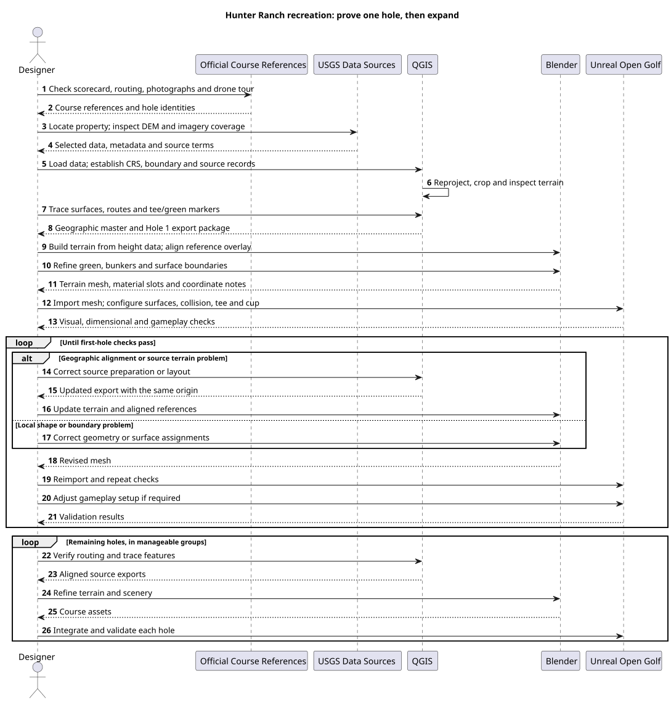

# Recreating Hunter Ranch Golf Course

Research checked: **13 November 2026**.

This walkthrough explains how to recreate **Hunter Ranch Golf Course, 4041 Highway 46 East,
Paso Robles, CA 93446**, using QGIS for geographic preparation, Blender for modelling, and
Unreal Open Golf for evaluation and play. The address is confirmed on the
[official scorecard page](https://www.hunterranchgolf.com/golf-course/scorecard).

**First milestone: one recognisable, correctly scaled Hole 1 with working ground collision,
surface types, a tee and a cup.** Extend the proven process to all 18 holes afterward.
This is an authoring guide, not a tested automated import pipeline. No Hunter Ranch datasets
have been downloaded or imported for this document; exact tile coverage, dates and accuracy
must be checked during the acquisition steps below.

Return to the [course-design research guide](README.md) for tool comparisons.

## Table of contents

- [Detailed companion guides](#detailed-companion-guides)
- [Workflow sequence](#workflow-sequence)
- [1. Collect Hunter Ranch references](#1-collect-hunter-ranch-references)
- [2. Prepare tools and folders](#2-prepare-tools-and-folders)
- [3. Locate and bound the course](#3-locate-and-bound-the-course)
- [4. Acquire elevation and imagery](#4-acquire-elevation-and-imagery)
- [5. Prepare the terrain in QGIS](#5-prepare-the-terrain-in-qgis)
- [6. Trace the golf layout](#6-trace-the-golf-layout)
- [7. Build the first hole in Blender](#7-build-the-first-hole-in-blender)
- [8. Export with consistent coordinates](#8-export-with-consistent-coordinates)
- [9. Integrate and validate in Unreal](#9-integrate-and-validate-in-unreal)
- [10. Expand to all 18 holes](#10-expand-to-all-18-holes)
- [Troubleshooting](#troubleshooting)
- [Completion checklist](#completion-checklist)
- [Documentation and references](#documentation-and-references)

## Detailed companion guides

Use the following reading order for menu-by-menu instructions, settings, examples and checks.
The original numbered walkthrough below remains the concise overview.

| Order | Guide | Deliverable |
| --- | --- | --- |
| 1 | [References](hunter_ranch_references.md) | Verified hole identity and source register |
| 2 | [Setup](hunter_ranch_setup.md) | Tools, version record and project folders |
| 3 | [Site boundary](hunter_ranch_site_boundary.md) | Study polygon and context extent |
| 4 | [Elevation and imagery](hunter_ranch_elevation_imagery.md) | Source data with metadata |
| Optional | [LiDAR processing](hunter_ranch_lidar_processing.md) | Derived ground raster if required |
| 5 | [QGIS terrain](hunter_ranch_qgis_terrain.md) | Validated geographic elevation master |
| 6 | [QGIS layout](hunter_ranch_qgis_layout.md) | Surface, route and marker layers |
| 7 | [Blender](hunter_ranch_blender.md) | Detailed first-hole mesh and source file |
| 8 | [Export and coordinates](hunter_ranch_export_coordinates.md) | Calibrated mesh and marker handoff |
| 9 | [Unreal](hunter_ranch_unreal.md) | Imported terrain and gameplay integration checklist |
| Optional | [Landscape](hunter_ranch_landscape.md) | Alternative broad terrain representation |
| 10 | [Environment](hunter_ranch_environment.md) | Scenery with measured performance cost |
| 11 | [Full course](hunter_ranch_full_course.md) | Consistent 18-hole assembly |
| Throughout | [Validation](hunter_ranch_validation.md) | Recorded evidence and completion gates |
| As needed | [Troubleshooting](hunter_ranch_troubleshooting.md) | Diagnosis and recovery procedures |
| Reference | [Resources](hunter_ranch_resources.md) | Official manuals, glossary and learning order |

## Workflow sequence

**Detailed guide:** [Detailed workflow and source handoffs](hunter_ranch_workflow.md).

The arrows represent work performed by the designer and files transferred between tools;
they do not imply existing automatic integrations.



Editable [PlantUML source](diagrams/hunter_ranch_sequence.puml). To regenerate the SVG
from the repository root, run:

```powershell
plantuml -tsvg Docs/CourseDesign/diagrams/hunter_ranch_sequence.puml
```

See [PlantUML sequence syntax](https://plantuml.com/sequence-diagram) for editing guidance.

In words: collect references, prepare geographic data, trace the course, build one hole,
test it in Unreal, correct the source, and then repeat for the remaining holes.

## 1. Collect Hunter Ranch references

**Detailed guide:** [Reference collection and scorecard verification](hunter_ranch_references.md).

1. Open the [official course information](https://www.hunterranchgolf.com/golf-course/information).
   Review its photographs and embedded drone tour. The club describes rolling terrain,
   established blue oaks, lakes and undulating greens with bunkers. Those are the main visual
   features to prioritise, rather than generic mountain terrain or dense forest.
2. Open the [scorecard](https://www.hunterranchgolf.com/golf-course/scorecard), select
   **Click to Enlarge/Print**, and record the access date. The card is an image, so inspect it
   visually before transcribing values. Do not substitute an aggregator's yardages without checking.
3. Create a reference table with `hole`, `par`, `tee_name`, `published_yards`, `source`, and
   `notes`. Transcribe Hole 1 first. Convert yards to metres with `yards * 0.9144`.
4. Make a reference sheet for Hole 1: tee view, landing area, approach, green, bunkers and
   nearby landmarks. Note timestamps in the drone tour when a view is useful. If a view's
   hole number is uncertain, mark it unresolved rather than assigning it by appearance.
5. Record a target visual season from your chosen photographs. Keep irrigated turf, dry areas,
   trees and lighting consistent with that reference set. Treat this as an artistic choice,
   not a statement about year-round conditions.

**Output/check:** a dated reference sheet and verified Hole 1 identity. Published yardage is
a reasonableness check; tee positions, doglegs and measurement conventions mean it need not
equal a straight line from an arbitrary tee point to the green centre.

## 2. Prepare tools and folders

**Detailed guide:** [Tool setup and workspace organisation](hunter_ranch_setup.md).

1. Install QGIS from its [official download page](https://qgis.org/download/). Use the
   documentation matching your installed version; the processing references below use 3.44.
2. Install Blender from [blender.org](https://www.blender.org/download/) and record its version.
   This workflow uses built-in mesh editing and displacement; OPCD is optional later study.
3. Use the Unreal version documented by this repository. Its existing research guide records
   a 5.8.4 baseline; check the current project before installing another version.
4. Create a working directory outside source control for the potentially large source data:

```text
HunterRanch/
  references/             # Source notes, scorecard transcription, photo references
  source/elevation/       # Untouched downloads and metadata
  source/imagery/         # Untouched orthophotos and metadata
  gis/                    # hunter_ranch.qgz and hunter_ranch.gpkg
  processed/              # Derived GeoTIFFs, hillshade and aligned overlays
  blender/                # Editable .blend masters
  exports/                # Meshes, heightmaps and coordinate notes
  validation/             # Measurements, screenshots and corrections
```

5. In `references/sources.md`, record each source's URL, access date, acquisition date,
   dataset/tile identifier, resolution, horizontal CRS, vertical datum, elevation units,
   accuracy statement and usage terms. Record unknown values explicitly.

**Output/check:** reproducible source records. A saved image of a map is not a georeferenced
elevation raster, and publicly viewable photographs are not automatically reusable textures.

## 3. Locate and bound the course

**Detailed guide:** [Site boundary and coordinate system](hunter_ranch_site_boundary.md).

1. Launch [USGS LidarExplorer](https://www.usgs.gov/tools/lidarexplorer) and locate
   `Hunter Ranch Golf Course, Paso Robles, California`. Try the full street address if needed.
   If address search is unavailable, navigate to Paso Robles and Highway 46 East using the map.
2. Match the property against the official course references. An address pin may identify
   the entrance or clubhouse; it does not define the course extent.
3. In QGIS, save a new project as `gis/hunter_ranch.qgz`. Set the project CRS using the
   status-bar CRS selector to **NAD83 / UTM zone 10N, EPSG:26910**, a metre-based working
   choice for this location. Keep each source's actual CRS assigned to that source.
4. Once reference imagery is loaded in the next step, create a polygon layer named `aoi`
   in `hunter_ranch.gpkg` using **Layer > Create Layer > New GeoPackage Layer**.
5. Trace a study boundary containing all golf holes and practice/clubhouse context visible
   in the references. This is a modelling boundary, not a surveyed property line.
6. Run **Buffer** from the Processing Toolbox with a suggested starting distance of **100 m**.
   Expand it where distant scenery or nearby hole sightlines need more coverage. Use the
   buffered extent when selecting downloads; refine it after all holes are identified.

**Output/check:** an area of interest covering all 18 holes without clipping greens or tees.
Do not commit to geographic coordinates copied from an unverified search result.

## 4. Acquire elevation and imagery

**Detailed guide:** [Elevation and imagery acquisition](hunter_ranch_elevation_imagery.md); optional [LiDAR processing](hunter_ranch_lidar_processing.md).

### Elevation

1. In LidarExplorer, inspect DEM availability over the whole study area. Prefer a suitable
   **1 m bare-earth DEM** where available; this preference does not confirm local coverage.
2. Open the product metadata. Check acquisition year, horizontal and vertical reference systems,
   units, accuracy, tile footprints and whether the raster represents ground or surface objects.
3. Download every intersecting tile, including the context margin, and save metadata alongside it.
   Prefer a consistent acquisition project to mixing different dates and vertical references.
4. If only coarse elevation is available, use it for a broad terrain preview. Record that greens
   and bunkers require better measurements or deliberate approximation.
5. If classified LiDAR is available but no useful DEM is supplied, treat PDAL ground-point
   processing as an advanced branch: inspect classifications, select ground points, rasterise
   at a justified spacing, and inspect gaps. Trees and roofs must not become playable ground.
   Start with the [PDAL documentation](https://pdal.io/en/stable/) before building that pipeline.

USGS explains discovery in [LidarExplorer](https://www.usgs.gov/tools/lidarexplorer) and product
differences in [3DEP products and services](https://www.usgs.gov/3d-elevation-program/about-3dep-products-services).

### Aerial imagery

1. Use [The National Map download guidance](https://www.usgs.gov/the-national-map-data-delivery/gis-data-download)
   and its NAIP imagery index to locate orthophotos covering the same area.
2. Inspect the actual acquisition date and pixel size. Select a consistent imagery set with
   clear surface boundaries. Compare it with the official photographs for course changes.
3. Download georeferenced imagery where offered. A streamed basemap is useful for browsing,
   but a local georeferenced image gives you a repeatable modelling reference.
4. Load imagery and DEM files into QGIS by dragging them onto the map canvas. Open each
   layer's **Properties > Information** and copy its spatial information into the source record.

**Output/check:** complete geographic coverage with source dates recorded. No exact local
DEM project, imagery year or tile identifier is asserted here. Verify those in the catalog;
do not infer coverage from a dataset merely mentioning San Luis Obispo County.

## 5. Prepare the terrain in QGIS

**Detailed guide:** [Detailed QGIS terrain preparation](hunter_ranch_qgis_terrain.md).

1. Inspect each raster before processing. If its CRS is missing, recover it from authoritative
   metadata. Changing the project CRS changes the view; it does not reproject stored data.
2. If tiles share compatible CRS, units and elevation reference, use **Build Virtual Raster**
   to assemble a working mosaic. Resolve incompatible sources before merging them.
3. Run **Warp (reproject)** to EPSG:26910, writing a Float32 GeoTIFF. Use bilinear resampling
   for continuous elevations and retain a resolution justified by the source, such as 1 m
   for a 1 m source. Reprojection is different from simply assigning a new CRS label.
4. Horizontal reprojection alone does not establish a vertical-datum conversion. Keep a
   consistent documented vertical reference and convert elevation units to metres when needed.
5. Use **Clip Raster by Mask Layer** with the buffered study area. Preserve NoData outside
   the mask. Save the terrain master as `processed/hunter_ranch_dem_m.tif`.
6. Generate **Hillshade** and inspect ridges, depressions, tile seams and unexpected spikes.
   Compare with imagery. Create 1 m contours as a broad inspection aid if useful; finer
   contour intervals do not establish finer source accuracy.
7. Inspect NoData across playable areas. Prefer recovering missing coverage over filling large
   holes. Document any small interpolated repairs and inspect their effect on local slopes.
8. Reproject/crop the imagery to the same working CRS. For modelling exports, align its bounds
   exactly with the terrain patch. Keep the full geographic masters for later corrections.

**Output/check:** a continuous ground raster, hillshade and aligned imagery. Use the Identify
tool to check several elevations; a canopy-shaped mound or a vertical tile step needs investigation.
See QGIS's [raster projection tools](https://docs.qgis.org/3.44/en/docs/user_manual/processing_algs/gdal/rasterprojections.html).

## 6. Trace the golf layout

**Detailed guide:** [Detailed QGIS layout tracing](hunter_ranch_qgis_layout.md).

1. Create the following layers in `hunter_ranch.gpkg`, all in the working CRS:

| Layer | Geometry | Suggested fields |
| --- | --- | --- |
| `surfaces` | Polygon | `hole_id`, `surface`, `source`, `confidence`, `notes` |
| `routes` | Line | `hole_id`, `par`, `notes` |
| `markers` | Point | `hole_id`, `kind`, `tee_name`, `source`, `notes` |
| `context` | Polygon or separate geometry-specific layers | `feature`, `source`, `notes` |

2. Enable editing and trace Hole 1's green, collar where visible, fairway, teeing areas,
   rough transitions and bunkers. Add water where verified. Use the snapping toolbar to
   help adjacent boundaries meet; avoid unintended slivers and overlaps.
3. Add a route from tee through the intended landing area to green. Confirm hole numbering
   from official references rather than assuming the nearest next green is the correct one.
4. Place a representative tee marker and a `green_center` reference marker. Use `pin_candidate`
   for a proposed cup position; a green centre is not evidence of an actual cup location.
5. Measure the route and compare with the corresponding scorecard tee. Investigate a substantial
   discrepancy before changing the terrain scale. It may be the wrong tee, routing or hole identity.
6. Trace cart paths, tree groups, water boundaries and clubhouse context on separate layers.
   Record obscured edges as approximate; do not trace shadows as physical features.

**Output/check:** an editable Hole 1 layout aligned with imagery. These are suggested authoring
fields, not an implemented schema consumed by Unreal. Retain the GeoPackage master;
standard GeoJSON uses WGS84 longitude/latitude, not arbitrary local metre coordinates.

## 7. Build the first hole in Blender

**Detailed guide:** [Detailed Blender modelling walkthrough](hunter_ranch_blender.md).

### Prepare a height and reference package

1. Select a rectangular Hole 1 patch containing the tee, route, green and adjacent context.
   Crop from the geographic master and record its bounds, width, height and raster dimensions.
2. Choose and record a shared course origin `(E0, N0, H0)` in metres. A convenient choice is
   near the study area's southwest corner, with a nearby round elevation for `H0`. Use the
   same origin for all future hole patches; do not independently centre every export.
3. Inspect the patch's valid minimum and maximum elevations, `Hmin` and `Hmax`. After resolving
   NoData within this rectangular patch, encode elevations as unsigned 16-bit grayscale:

   `value = round((height - Hmin) / (Hmax - Hmin) * 65535)`

   Preserve the Float32 master. If the range is zero, use a flat plane instead of dividing by zero.
4. In QGIS, **Translate (convert format)** can expose GDAL's additional command-line parameters.
   Use UInt16 output and `-scale Hmin Hmax 0 65535`, replacing the two height placeholders with
   actual numbers; select PNG output. This requires GDAL support in the installed QGIS build.
   Export elevation values, not a screenshot or colour-rendered hillshade.
5. Export a matching top-down reference image with surface outlines over the imagery. Use
   an identical rectangular map extent and preserve its aspect ratio. This overlay is a
   modelling reference; the GeoPackage remains the editable layout master.

See [QGIS raster conversion](https://docs.qgis.org/3.44/en/docs/user_manual/processing_algs/gdal/rasterconversion.html)
and [GDAL Translate](https://gdal.org/en/stable/programs/gdal_translate.html) for the export controls.

### Create and refine the terrain

1. In Blender, set **Scene Properties > Units** to Metric, unit scale 1. Create an XY plane
   and give it the patch's measured dimensions in metres; apply its scale.
2. Subdivide the plane into a regular grid before displacement. Start at roughly the DEM
   sample spacing, or coarser for an initial preview, using only this hole-sized patch.
   Add local density later where shaping requires it.
3. UV-map the entire plane to the height image. Add a **Displace** modifier using the image
   texture and UV coordinates, with direction Z. Treat height samples as linear data:
   use Non-Color where available and disable legacy texture colour-space conversion.
4. Set midlevel to 0 and strength to `Hmax - Hmin`. Position the plane vertically at
   `Hmin - H0`, and horizontally at its patch centre relative to `(E0, N0)`.
   Thus black represents the patch minimum, rather than an arbitrary sea-level height.
5. Align the image orientation with east/right and north/up in top view. Raster samples
   represent pixel centres: the span between first and last samples is `(count - 1) * spacing`.
   Account for the half-pixel border when mapping texture samples to a mesh; do not silently
   equate the outer raster bounds with the sample-centre span.
6. Check at least three separated control points against QGIS, including one near each end
   of the hole. Check heights as well as horizontal locations before sculpting.
7. Use the matching overlay as a temporary material/reference. Preserve a copy of the
   unmodified terrain, then apply displacement on a working copy when mesh editing requires it.
8. Cut/subdivide faces along the traced golf boundaries and assign material slots such as
   `Green`, `Fringe`, `Fairway`, `Rough` and `Sand`. Keep shared boundary vertices continuous.
   A first pass can use simple colours so boundary mistakes are easy to see.
9. Refine green transitions, bunker floors and lips using reference views. Mark any inferred
   contour changes in your notes. Do not claim surveyed putting accuracy from a 1 m DEM.
10. Save `blender/hunter_ranch_h01.blend`, including a 10 m calibration object and labelled
    tee/green reference markers. Keep reference geometry out of the final terrain export.

**Output/check:** correctly scaled terrain with distinguishable golf surfaces and no cracks.
The [Blender manual](https://docs.blender.org/manual/en/latest/) covers UV mapping, subdivision,
Displace and material assignment. Its detailed Displace page could not be fetched during this
research; verify controls in your installed version. This recipe has not been run end to end.

## 8. Export with consistent coordinates

**Detailed guide:** [Coordinate conversion, height encoding and export](hunter_ranch_export_coordinates.md); optional [Landscape route](hunter_ranch_landscape.md).

Use a **mesh export for the first hole** because it carries the detailed geometry and material
slots together. Landscape is an alternative broad-terrain route, not an extra required step.

1. Create an export copy of the terrain. Inspect normals, remove accidental duplicate faces,
   and make triangulation predictable before testing golf-ball roll across the surface.
2. Export selected terrain objects to FBX, preserving separate material slots. Record Blender
   units, FBX axis/unit settings, origin, source bounds and height encoding in `exports/coordinates.md`.
3. Export the 10 m calibration object separately. Import it first in Unreal and verify it
   measures **1,000 cm**. Correct export/import units before bringing in the terrain.
4. In the same note, record the chosen map convention. A simple target is Unreal `+X = east`,
   `+Y = north`, `+Z = up`, with centimetres computed from the geographic origin:

```text
X_cm = 100 * (E - E0)
Y_cm = 100 * (N - N0)
Z_cm = 100 * (H - H0)
```

5. Check that the FBX import actually matches that convention using asymmetric east/north
   reference markers. Exporters may rotate or reflect axes; verify instead of relying on defaults.
6. Record tee/pin coordinates in a small CSV or table for manual placement. These records
   do not automatically create Unreal gameplay actors. Place marker Z on the final edited
   surface if modelling changed the original DEM height.

**Landscape alternative:** follow Epic's [heightmap import guide](https://dev.epicgames.com/documentation/en-us/unreal-engine/importing-and-exporting-landscape-heightmaps-in-unreal-engine)
and [Landscape technical guide](https://dev.epicgames.com/documentation/unreal-engine/landscape-technical-guide-in-unreal-engine).
Choose a supported grid size, retain the intended sample spacing and calculate both vertical
scale and offset from the recorded elevation encoding. Do not stretch a raster merely to fit
a component count. Select documentation for the project's Unreal version. Landscape materials,
detail-mesh joins and physical-surface detection require their own validation.

## 9. Integrate and validate in Unreal

**Detailed guide:** [Detailed Unreal integration](hunter_ranch_unreal.md) and [validation procedures](hunter_ranch_validation.md).

The existing [OpenGolfCourse kit](../../Plugins/OpenGolfCourse/README.md) supplies physical
surfaces, cups, flags and hole-play building blocks. Its [reference](../../Plugins/OpenGolfCourse/Docs/Reference.md)
documents material assignments and scripted layout helpers. It does not establish an automatic
importer for this QGIS/Blender package or a completed 18-hole Hunter Ranch game mode.

1. Create a separate test map for the course. Import the calibrated Hole 1 mesh and inspect
   it from top view and player height before adding decorative assets.
2. Assign existing course material instances where appropriate, including `MI_Green`,
   `MI_Fairway` and `MI_Rough`. For other slots, follow the kit's material instructions and
   assign the matching physical material, such as `PM_Sand` or `PM_Fringe`.
3. Configure collision so the ball encounters the actual terrain shape. A coarse convex hull
   spanning a whole hole cannot represent its ground. Validate the collision representation
   used by the game's ball traces, including per-surface physical-material results.
4. Transfer the tee reference and candidate cup position using the documented coordinate
   convention. Use the kit's cup/flag components and existing hole setup as implementation
   references. Wiring tee selection, round flow and scoring into a new map may require code
   or editor scripting; those integrations are future work, not supplied by the FBX.
5. Run the checks below before extending the course:

| Check | Pass condition |
| --- | --- |
| Scale | Calibration object is 1,000 cm; measured landmark distances agree with the source |
| Alignment | At least three control points match; terrain is neither mirrored nor rotated |
| Elevation | Selected imported heights agree with the encoded terrain, allowing quantisation |
| Routing | Hole 1 tee and green identity match references; yardage discrepancy is explained |
| Surfaces | Ball detects the intended surface on both sides of each visible boundary |
| Continuity | Slow rolls cross green/fringe and bunker boundaries without artificial seams |
| Cup | Ground and cup meet correctly; the integrated gameplay can register a holed ball |
| Performance | Frame time is recorded from tee, approach and green on the target machine |

6. Log corrections in `validation/`, fix the authoritative source, and re-export using the
   same origin. Keep artistic refinements separate from measured elevation claims.

**Output/check:** the first-hole milestone is complete only when the gameplay integration
and checks pass. A visually successful FBX import alone is an intermediate result.

## 10. Expand to all 18 holes

**Detailed guide:** [Environment and scenery](hunter_ranch_environment.md), then [full-course expansion](hunter_ranch_full_course.md).

1. Finish the full routing and scorecard transcription in QGIS. Verify each hole's tee groups,
   green identity, par and order against official references.
2. Work in small groups of adjacent holes using the same origin and geographic master.
   Share terrain along borders rather than making overlapping independent collision surfaces.
3. Repeat the first-hole validation for each addition. Add further tee sets and documented
   candidate pins after the basic routing works. Keep practice greens distinct from numbered holes.
4. Add the course's characteristic oaks and other vegetation from dated reference imagery.
   Use canopy locations for scenery, while retaining bare-earth geometry for the ground.
5. Refine verified water areas, paths and clubhouse context. Use the official drone tour to
   judge silhouettes and sightlines; avoid inventing detailed landmarks that cannot be verified.
6. Apply consistent seasonal turf and background colours. Add fine vegetation near gameplay
   views, then measure performance before increasing density elsewhere.
7. Play through the complete routing once round-flow integration exists, checking transitions,
   tee selection, cups, surface boundaries and viewpoints. Preserve all editable masters.

**Output/check:** all holes share one coordinate system and a documented source history.
Visual fidelity and putting accuracy should be reported separately.

## Troubleshooting

**Detailed guide:** [Detailed diagnosis and recovery](hunter_ranch_troubleshooting.md).

| Symptom | Likely cause and next check |
| --- | --- |
| Terrain and imagery disagree | Check actual source CRS, acquisition dates, crop bounds and export orientation |
| Terrain is 100 times too large/small | Recheck metre-to-centimetre conversion with the calibration object |
| Greens are blocky or unnaturally smooth | Check source resolution and processing; upsampling cannot recover missing detail |
| Terrain has steps or spikes | Inspect NoData, tile seams, vertical units, height encoding and image colour conversion |
| Trees appear as hills | A surface model or unfiltered point cloud was used instead of ground elevation |
| Overlay is slightly shifted | Check pixel-centre versus pixel-edge alignment and identical crop extents |
| Whole course is mirrored | Check east/north control markers and FBX axis conversion |
| Sand looks right but plays as grass | Inspect physical materials and the material returned by collision traces |
| Ball jumps at a boundary | Check duplicated collision, cracks, mismatched heights and collision simplification |
| Scorecard distance disagrees | Confirm tee set, hole identity and dogleg route before rescaling the course |

## Completion checklist

**Detailed guide:** [Validation records and completion gates](hunter_ranch_validation.md).

- [ ] Official references, source dates and imagery/elevation terms recorded.
- [ ] Actual dataset coverage and accuracy checked; no assumed local tile coverage.
- [ ] Geographic masters, working CRS, vertical reference and units preserved.
- [ ] Hole 1 terrain, layout, coordinate conversion and gameplay validated.
- [ ] Green-centre references distinguished from candidate or measured pin locations.
- [ ] Inferred contours documented separately from measured terrain.
- [ ] All 18 holes identified, with tee sets, pars and routing checked.
- [ ] Materials and collision agree at visible golf-surface boundaries.
- [ ] Shared terrain joins, cups and round flow tested.
- [ ] Frame-time observations and remaining inaccuracies documented.
- [ ] QGIS, Blender and export masters retained for future revisions.

## Documentation and references

**Detailed guide:** [Annotated resources and glossary](hunter_ranch_resources.md).

| Reference | Use it for |
| --- | --- |
| [Hunter Ranch official website](https://www.hunterranchgolf.com/) | Course identity and current official links |
| [Course information and drone tour](https://www.hunterranchgolf.com/golf-course/information) | Landscape character and visual references |
| [Official scorecard](https://www.hunterranchgolf.com/golf-course/scorecard) | Verify hole pars, tee names and yardages visually |
| [USGS LidarExplorer](https://www.usgs.gov/tools/lidarexplorer) | Discover elevation coverage and metadata |
| [3DEP product guidance](https://www.usgs.gov/3d-elevation-program/about-3dep-products-services) | Understand DEM and LiDAR products |
| [The National Map downloads](https://www.usgs.gov/the-national-map-data-delivery/gis-data-download) | Find elevation and NAIP imagery download paths |
| [QGIS training manual](https://docs.qgis.org/latest/en/docs/training_manual/) | Learn projects, layers, digitising and raster work |
| [GDAL Translate reference](https://gdal.org/en/stable/programs/gdal_translate.html) | Verify raster type conversion and value scaling |
| [Blender manual](https://docs.blender.org/manual/en/latest/) | Learn mesh editing, UVs, displacement and export |
| [Epic Landscape heightmap import](https://dev.epicgames.com/documentation/en-us/unreal-engine/importing-and-exporting-landscape-heightmaps-in-unreal-engine) | Optional heightfield-based terrain handoff |
| [Local course kit reference](../../Plugins/OpenGolfCourse/Docs/Reference.md) | Existing surfaces, cups and gameplay integration points |
| [Local turf workflow](../TurfWorkflow.md) | Existing Blender/Unreal grass asset workflow |
| [PlantUML sequence diagrams](https://plantuml.com/sequence-diagram) | Maintain or render this document's sequence |

The geographic and modelling instructions are a recommended workflow. Source catalogs and UI
labels can change; inspect current metadata and match documentation to installed tool versions.
