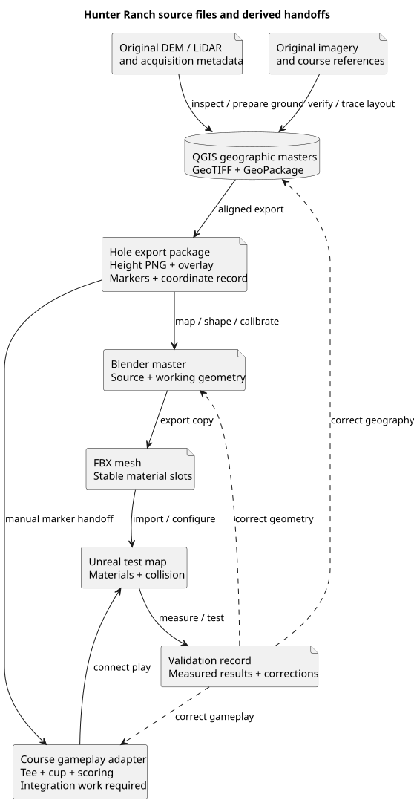

# Hunter Ranch: workflow and reading order

[Overview](course_hunter_ranch.md) | Next: [References](hunter_ranch_references.md)

This series takes Hunter Ranch in Paso Robles from geographic references to a candidate playable
course. It is a GUI-first authoring recipe, researched on 13 November 2026, not a report of a
completed reconstruction. Local source code was inspected; the external data-to-game pipeline
has not been executed. Acquisition dates, coordinates and actual terrain heights remain values
you must establish. Numerical demonstrations are explicitly labelled examples.

## Table of contents

- [Choose your route](#choose-your-route)
- [Read and work in order](#read-and-work-in-order)
- [First working session](#first-working-session)
- [Files and handoffs](#files-and-handoffs)
- [Handoff readiness checklist](#handoff-readiness-checklist)
- [Milestone gates](#milestone-gates)
- [Working conventions](#working-conventions)
- [Repeat a correction](#repeat-a-correction)

## Choose your route

Use **supplied DEM → QGIS → Blender mesh → Unreal** for the first hole. A DEM is a raster of
ground elevations. Choose raw LiDAR processing only if the supplied DEM is unsuitable and
better point data exists. Choose Landscape as an alternative for broad terrain after the
mesh path establishes your units and gameplay requirements. Neither optional branch is
required just because its guide is included here.

The [rendered sequence in the overview](course_hunter_ranch.md#workflow-sequence) shows the
order. Start with Hole 1 and plain surface colours. Delay dense vegetation and clubhouse
detail until scale, terrain, surface detection and cup behaviour work.

## Read and work in order

| Order | Guide | Deliverable |
| --- | --- | --- |
| 1 | [References](hunter_ranch_references.md) | Verified hole identity and source register |
| 2 | [Setup](hunter_ranch_setup.md) | Tools, version record and project folders |
| 3 | [Site boundary](hunter_ranch_site_boundary.md) | Study polygon and context extent |
| 4 | [Elevation and imagery](hunter_ranch_elevation_imagery.md) | Source data with metadata |
| Optional | [LiDAR processing](hunter_ranch_lidar_processing.md) | Derived ground raster if required |
| 5 | [QGIS terrain](hunter_ranch_qgis_terrain.md) | Validated geographic elevation master |
| 6 | [QGIS layout](hunter_ranch_qgis_layout.md) | Surface, route and marker layers |
| 7 | [Blender](hunter_ranch_blender.md) | Detailed first-hole mesh and source file |
| 8 | [Export and coordinates](hunter_ranch_export_coordinates.md) | Calibrated mesh and marker handoff |
| 9 | [Unreal](hunter_ranch_unreal.md) | Imported terrain and gameplay integration checklist |
| Optional | [Landscape](hunter_ranch_landscape.md) | Alternative broad terrain representation |
| 10 | [Environment](hunter_ranch_environment.md) | Scenery with measured performance cost |
| 11 | [Full course](hunter_ranch_full_course.md) | Consistent 18-hole assembly |
| Throughout | [Validation](hunter_ranch_validation.md) | Recorded evidence and completion gates |
| As needed | [Troubleshooting](hunter_ranch_troubleshooting.md) | Diagnosis and recovery procedures |
| Reference | [Resources](hunter_ranch_resources.md) | Official manuals, glossary and learning order |

Before starting Blender, read the [coordinate record](hunter_ranch_export_coordinates.md#create-the-coordinate-record)
and [height encoding](hunter_ranch_export_coordinates.md#encode-a-height-image) sections of the
export guide. Its remaining FBX instructions apply after modelling. This avoids creating the
terrain with an undocumented origin or an incorrectly encoded height image.

## First working session

Start with the following bounded exercise. Its finish line is a documented data-selection
decision, not a completed course model.

1. Create the external `HunterRanch/` working folders using the setup guide. Create
   `references/sources.md` and `references/tool_versions.md` from their templates.
2. Open the official course references. Record the address, scorecard URL and reference date.
   Transcribe Hole 1 only, and record any uncertainty about identifying it in imagery.
3. Locate the entire course in the USGS discovery tools. Record candidate elevation and imagery
   products and inspect their footprints before downloading bulk data.
4. Choose a small set of files covering the first-hole study area and its context. If Hole 1
   cannot yet be identified confidently, use a clearly labelled course-wide discovery extent
   and resolve routing before selecting a modelling patch.
5. Load the chosen files into QGIS. Save the project, record CRS, vertical units, source dates
   and missing coverage, then close and reopen the project to verify its file references.
6. Write the next action in the source notes: proceed with the supplied DEM, investigate raw
   LiDAR, obtain missing coverage, or resolve uncertain hole identity.

At the end, you should be able to explain which data you intend to use and why. If coverage or
metadata remains unresolved, keep that as the next task rather than starting detailed sculpting.

## Files and handoffs

Editable [PlantUML source](diagrams/hunter_ranch_handoffs.puml). From the repository root,
regenerate it with `plantuml -tsvg Docs/CourseDesign/diagrams/hunter_ranch_handoffs.puml`.

The working folder `HunterRanch/` is separate from the repository's documentation directory.
The [setup guide](hunter_ranch_setup.md) specifies its layout. A `.qgz` stores QGIS project
settings and layer references; a `.gpkg` stores editable geographic features; a GeoTIFF stores
elevation and its georeferencing. None of these is itself an Unreal course asset.

| Authoritative file | Derived output | When to rebuild |
| --- | --- | --- |
| Original DEM and metadata | Working DEM | Source, CRS, units or study extent changes |
| Working DEM | Hole height PNG and coordinate record | Crop or terrain processing changes |
| GeoPackage | Reference overlay and marker CSV | Traced boundaries or routing changes |
| Blender master | FBX terrain | Geometry, material slots or export settings change |
| FBX and coordinate record | Unreal mesh and placed actors | Export changes, followed by validation |

Keep the geographic masters after import. Recreating them from an engine mesh loses source
history and may lose elevation precision or editable golf boundaries.

## Handoff readiness checklist

Use this table before opening the next tool. Filenames are proposed working outputs inside
the external `HunterRanch/` directory; they are not files supplied by this documentation.

| Handoff | Required files or records | Check before proceeding |
| --- | --- | --- |
| Discovery to QGIS | Original files under `source/`; `references/data_inventory.csv`; study boundary | Coverage, acquisition dates, CRS and height units are recorded |
| QGIS terrain to layout | `gis/hunter_ranch.qgz`; `gis/hunter_ranch.gpkg`; `processed/hunter_ranch_dem_m.tif` | No unexplained seams, missing playable ground or mismatched imagery |
| QGIS to Blender | `processed/h01/h01_dem_m.tif`; `processed/h01/h01_height_u16.png`; aligned overlay; control markers; `exports/coordinates.md` | Same patch bounds; valid height range; documented origin and pixel-centre convention |
| Blender to FBX | Numbered `.blend` master; export copy; named material slots; separate calibration geometry | Source retained, units verified, boundaries continuous and triangulation inspected |
| FBX to Unreal | Terrain FBX; calibration FBX; `exports/h01/h01_markers.csv`; import settings | 10 m bar, axes and three control points pass before gameplay setup |
| Visual map to playable hole | Final ground hits; cup descriptor; tee/par data; implemented game adapter | Ball queries and scoring use the new course rather than the default range |
| First hole to full course | Accepted first-hole revision; `validation/h01_revision_001.md`; hole inventory | Remaining integration gaps are explicit and common transforms are fixed |

The overlay's filename can be chosen when it is exported; record that exact filename and its
geographic extent beside the height image. A PNG without its coordinate record is an incomplete
handoff even if it looks correct when opened.

## Milestone gates

1. **Identity:** Hole 1 is unambiguously matched to official references. An unlabeled green in
   aerial imagery is not enough. Leave uncertainty recorded until resolved.
2. **Ground:** the whole first-hole patch has usable elevation coverage in consistent units.
   Tree canopy, NoData and tile seams are understood before modelling.
3. **Geometry:** a 10 m calibration object and three control points transfer correctly.
   Course dimensions do not depend on eyeballing the imported mesh.
4. **Play:** the ball uses the visible surfaces, crosses seams normally, and recognises the cup.
   This requires integration beyond importing FBX; see the Unreal guide.
5. **Expansion:** only after these checks pass, apply the same process to neighbouring holes.

## Working conventions

Use EPSG:26910 as the proposed horizontal working CRS, metres in geographic processing and
Blender, and centimetres in Unreal. Preserve the source's vertical reference; never assume
horizontal reprojection converted heights. Choose one `(E0, N0, H0)` for the entire course.
The export guide owns the conversion rules and worked arithmetic.

Name numbered holes `h01` through `h18`. Name greens used for practice separately. Use
`green_center` for a mapping reference and `pin_candidate` for an authored cup position.
These names describe this documentation's proposed working data, not an existing game schema.

## Repeat a correction

Record the observed error, its likely owning file, and the expected check. For example, if
every landmark shifts equally, fix the coordinate handoff before moving individual actors.
If a traced bunker edge is wrong, fix the GeoPackage and update the mesh boundary. If only
ball response is wrong, investigate material and collision configuration before changing shape.

Save a numbered revision before destructive modelling operations. Export to a revisioned file,
reimport into the test map, repeat the affected checks, and record the result. No guide in
this series claims that a higher polygon count alone proves better ground accuracy.
