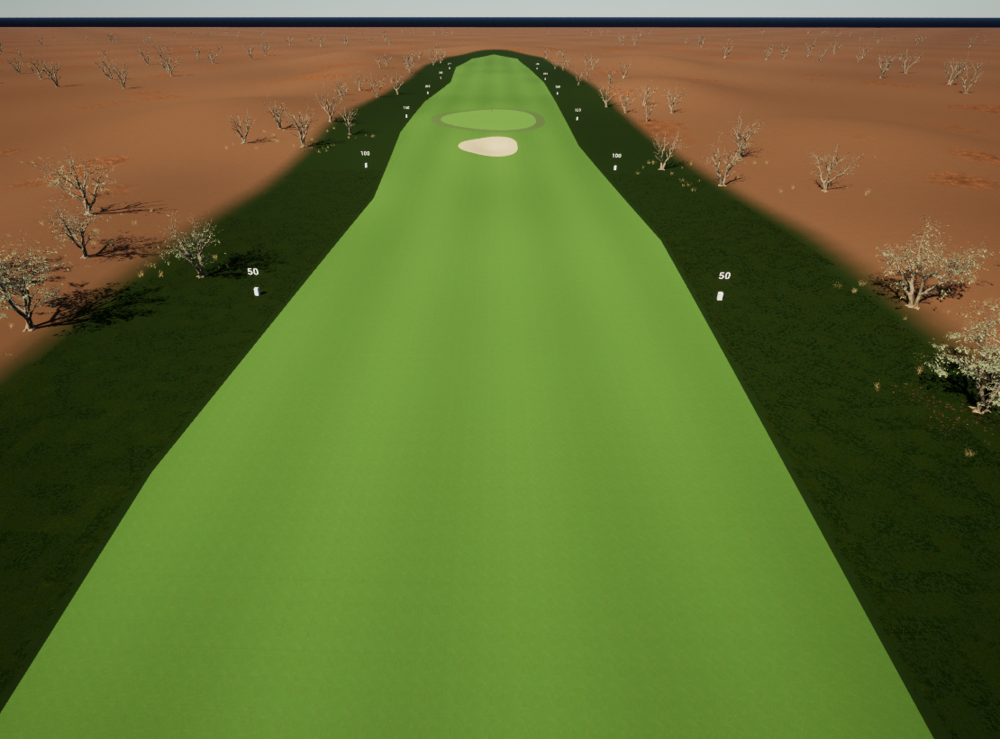

# Unreal Open Golf

An open-source golf game for Windows and Linux, built with Unreal Engine 5.8.4 and native C++.
Practise on the savanna driving range or play its 400-yard par 4. Use replay shots,
a Square Home launch monitor, or an Open Connect connector.



## Get started

Install Unreal Engine 5.8.4 with its C++ toolchain and Git LFS. Clone this repository,
then run `git lfs pull` if the assets were not downloaded during the clone.
No sibling repositories or launch-monitor hardware are required.

Run these commands from the repository root.

Windows PowerShell:

```powershell
$env:UE_ROOT = 'C:\Program Files\Epic Games\UE_5.8'
powershell -NoProfile -ExecutionPolicy Bypass -File Assets/Scripts/ue.ps1 Build
powershell -NoProfile -ExecutionPolicy Bypass -File Assets/Scripts/ue.ps1 Editor
```

Linux:

```bash
export UE_ROOT='/path/to/UnrealEngine-5.8.4'
bash Assets/Scripts/ue.sh build
bash Assets/Scripts/ue.sh editor
```

Press **Play**, then choose **Training**. Press **H** for a replay shot and **P** to
choose another. **C** connects a Square Home, **T** disconnects, **Tab** changes club,
and **F9** toggles recording while connected. **G** switches between range and hole
play. **Escape** closes an active panel or opens the pause menu.

For toolchain and graphics requirements, see [Development](Docs/Development.md).

## Guides

- [Playing, controls and recording](Docs/Playing.md)
- [Build and editor setup](Docs/Development.md)
- [Tests and validation](Docs/Testing.md)
- [CI and releases](Docs/Releases.md)
- [Architecture](Docs/Architecture.md) and [plugins](Plugins/README.md)
- [Range assets](Docs/RangeAssets.md) and [Blender turf workflow](Docs/TurfWorkflow.md)
- [Physics comparisons](Plugins/OpenFairwayPhysics/Docs/Reference.md#flightscope-comparisons-and-replay-shots)
- [Current status and remaining acceptance](Docs/PhasesStatus.md) and [asset licence roadmap](Docs/AssetLicenseRoadmap.md)

## Contributing

Keep changes focused, use plain English, and run checks appropriate to the change.
Use the repository's `.clang-format` for C++. Update the relevant guide when behavior
changes, and record validation with its engine version and platform. Preserve the
physics reference fixtures and existing asset licences.

## Licence

Original code, documentation and assets use the [MIT licence](LICENSE).
Unreal Engine and third-party assets retain their own licences. See
[Licensing](Docs/Licensing.md) and [third-party notices](THIRD_PARTY_NOTICES.md).
Only redistributable assets belong in this repository.
