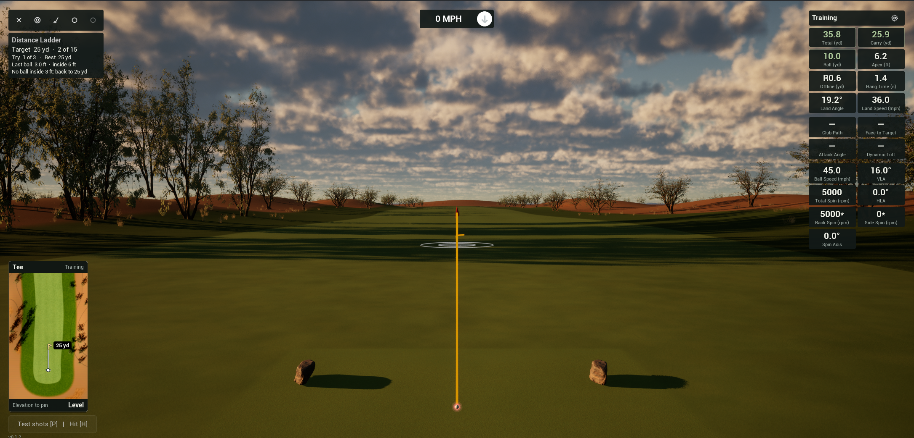

# Unreal Open Golf
Physics, Freedom, Golf! 

An open-source golf simulation game for Windows and Linux using Unreal Engine. We aim at being a fully open source, golf gaming simulation project. Contributors welcome, see [CONTRIBUTING.md](CONTRIBUTING.md) section. 

Supports Launch Monitor, and OpenAPI Connectivity

## Get started

Install from [Releases](https://github.com/digitalhand/uopengolf/releases). Every install updates itself from the game.
- Native Ubuntu/Debian `.deb` package.
- Native Fedora/openSUSE `.rpm` package.
- Portable `.tar.gz` for any Linux distribution.
- Native .exe Windows 64 installation.

- For developers. All code and assets are fully open source, most using MIT license. See below [Build and editor setup](Docs/Development.md)

Run these commands from the repository root.

For toolchain and graphics requirements, see [Development](Docs/Development.md).

## Guides

- [Playing, controls and recording](Docs/Playing.md)
- [Build and editor setup](Docs/Development.md)
- [Tests and validation](Docs/Testing.md)
- [CI and releases](Docs/Releases.md)
- [Architecture](Docs/Architecture.md) and [plugins](Plugins/README.md)
- [Content naming and layout](Docs/ContentNaming.md)
- [Range assets](Docs/RangeAssets.md) and [Blender turf workflow](Docs/TurfWorkflow.md)
- Physics: [how it works](Plugins/OpenFairwayPhysics/Docs/Reference.md) and [accuracy against reference shots](Plugins/OpenFairwayPhysics/Docs/Accuracy.md)
- [Current status and remaining acceptance](Docs/PhasesStatus.md) and [asset licence roadmap](Docs/AssetLicenseRoadmap.md)

## Contributing

See [CONTRIBUTING.md](CONTRIBUTING.md) for branches, code style, tests, asset rules and
the pull request checklist. In short: keep changes focused, run the checks for what you
changed, update the relevant guide, leave the physics pins (`UOpenGolf.Physics.GameplayPins`)
unchanged unless the physics is meant to change, and preserve existing asset licences.

## Licence

Original code, documentation and assets use the [MIT licence](LICENSE).
Unreal Engine and third-party assets retain their own licences. See
[Licensing](Docs/Licensing.md) and [third-party notices](THIRD_PARTY_NOTICES.md).
Only redistributable assets belong in this repository.
