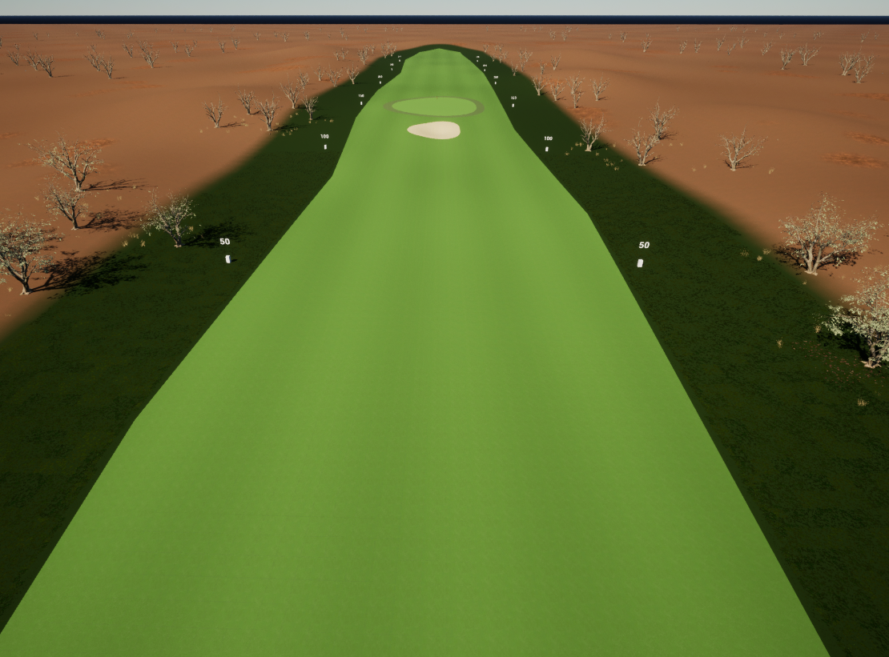
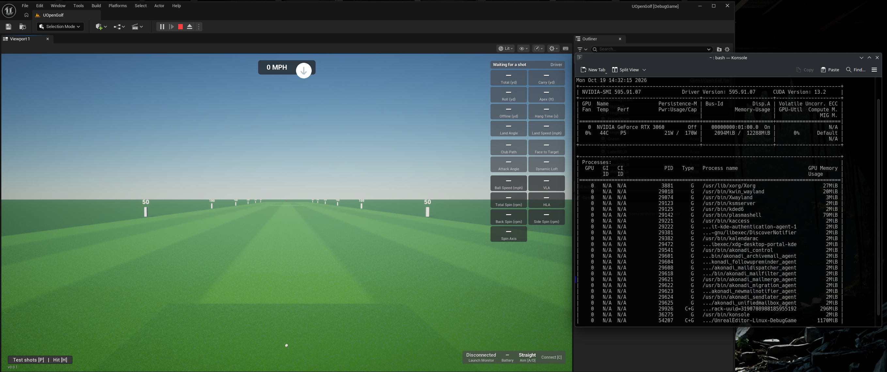
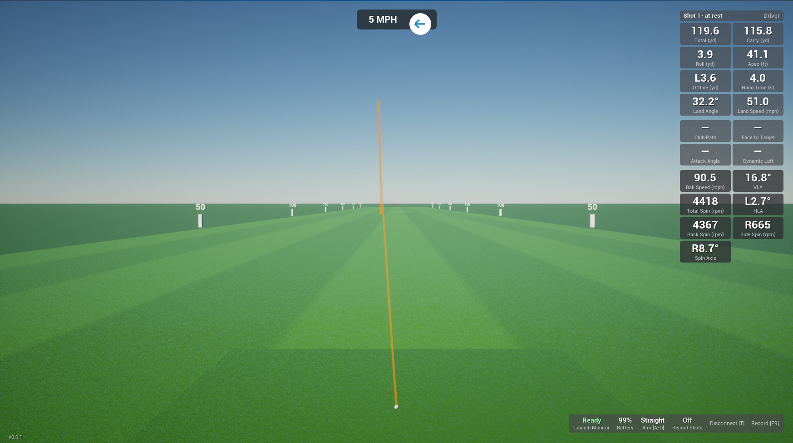
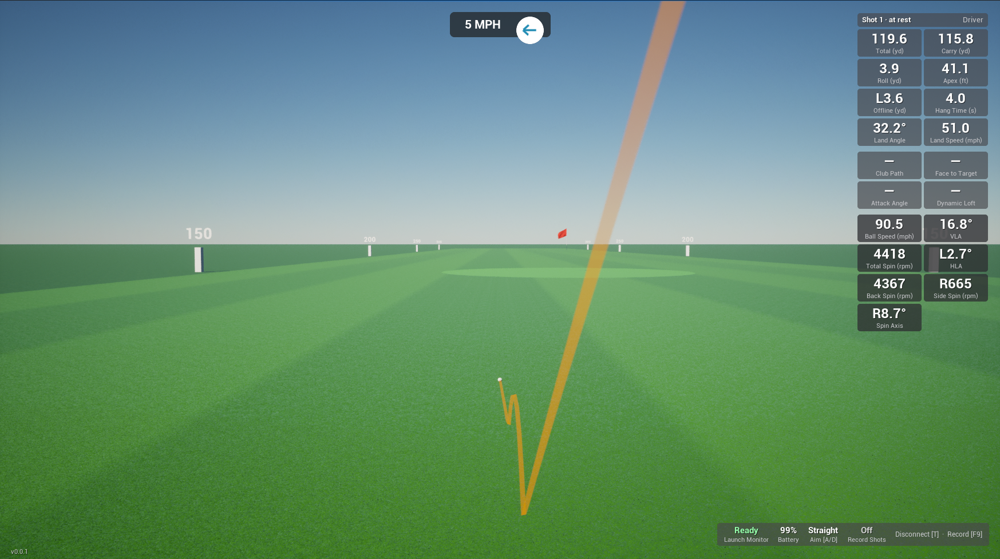

# Unreal Open Golf 

An open source golf game built with Unreal Engine and native C++, intended for
Windows and Linux. Original project code, documentation, and original assets use
the [MIT license](LICENSE). Unreal Engine and third-party content retain their own licenses.

## Table of contents

- [Current status](#current-status)
- [Platforms](#platforms)
- [Prerequisites](#prerequisites)
- [Getting started](#getting-started)
- [Game](#game)
  - [Controls](#controls)
  - [HUD](#hud)
  - [Changing clubs](#changing-clubs)
  - [Recording shots](#recording-shots)
  - [Recording errors and retries](#recording-errors-and-retries)
  - [Settings](#settings)
- [Developer](#developer)
  - [Build, run, and test](#build-run-and-test)
  - [Package (Windows and Linux)](#package-windows-and-linux)
  - [Engine version warning](#engine-version-warning)
  - [Visual Studio Code setup](#visual-studio-code-setup)
- [CI/CD](#cicd)
  - [How the pipeline works](#how-the-pipeline-works)
  - [Runner setup](#runner-setup)
  - [Public repository safety](#public-repository-safety)
  - [Versioning](#versioning)
  - [Making a release](#making-a-release)
  - [Test builds](#test-builds)
  - [Release assets](#release-assets)
  - [Limitations and troubleshooting](#limitations-and-troubleshooting)
- [Project structure and architecture](#project-structure-and-architecture)
- [Plugins](#plugins)
- [Driving range and ball physics](#driving-range-and-ball-physics)
  - [Grass and golf assets](#grass-and-golf-assets)
  - [Optional range visuals](#optional-range-visuals)
  - [FlightScope comparison](#flightscope-comparison)
  - [Shot library vs FlightScope](#shot-library-vs-flightscope)
  - [Hitting shots on the range](#hitting-shots-on-the-range)
  - [Selecting test shots](#selecting-test-shots)
- [Launch monitors and integrations](#launch-monitors-and-integrations)
  - [Testing launch-monitor capture](#testing-launch-monitor-capture)
- [Roadmap](#roadmap)
- [Contributing](#contributing)
- [Licensing and third-party assets](#licensing-and-third-party-assets)

## Current status

Play opens a driving range: shots from a Square Home or a replay are hit
from the tee and flown, bounced and rolled by native C++ golf physics, and the HUD
shows carry, roll, total, offline, apex, hang time and landing data. There is no
course, scoring or player character yet. Currently focused on foundation, eye candy came come later. 

### Current Features

- Fully playable in Windows and Linux using its own bluetooth libraries.
- Fully implemented physics carry, roll, surface, and wind. 
- Fully playable Square Home launch monitor, collects ball and club available data.
  - Also plays measured versus calculated ball data. Tested in measured only.
- Shot recording data (F9) saved to Documents folder. This allows to collect shot data, analyze, and adjust physics when needed. 


Newest build version with public assets (grass, trees, etc.).



The range in Play in the Linux editor, waiting for a shot, using Nvidia card:



A Square Home shot on Linux in a 5 mph wind, seen from the tee:



The same shot at rest, with the putting green and flag beyond it:




- Editor and game targets build; `ue.sh package` / `ue.ps1 Package` package the game and
  check that it starts.
- The `OpenLaunchMonitor` plugin: a native C++ port of the open-lm-connector Square
  protocol and session, Bluetooth LE transports for Windows (C++/WinRT) and Linux
  (BlueZ), built-in replay shots, and Blueprint/C++ events. Protocol, session, replay,
  cancellation and operation-wait tests pass. Async Bluetooth waits have cancellation
  and deadlines.
- The `OpenFairwayPhysics` plugin: a native C++ port of the ogolf-physics flight,
  impact, bounce and roll equations, with speed-dependent flight spin decay and
  continuous calibration. A historical profile matches the C# reference on 21
  golden fixtures. The ball actor uses Chaos scene queries for contact; its
  carry and rollout agree with the headless simulator in the range-shot test.
- The `OpenGolfCourse` plugin: a reusable course kit whose surface materials declare
  physics surfaces, with a waving flagstick, a marked golf ball and turf grass.
- The saved, editable range from that kit: a 34 m fairway with rough, optional 3D grass near
  the tee, yardage markers, follow camera and shot HUD.

Verified by the maintainer with a **real Square Home**: on Windows (2026-10-14/15), the
Bluetooth connection, battery and firmware readout, shot and club data, club selection
and shot recording; on Linux (2026-10-17, reported by the maintainer), the same plus
reconnect after a power cycle, disconnect and quitting while connected. The Linux
disconnect was changed on 2026-10-18 and awaits a hardware recheck.

The launch-direction HUD and nine-shot replay selector were inspected in rendered
captures on Windows (2026-10-14), and ball/flag dimensions and tracer behavior on
2026-10-15. Still outstanding: a full camera review, link-loss reconnect on Windows
hardware, a Square Home from a packaged game, and Linux rendered captures. See
[phase status](Docs/PhasesStatus.md) for evidence.

Launch-monitor hardware and purchased content are optional; replay shots work
without hardware.

## Platforms

| Platform | Intended support | Verification |
| --- | --- | --- |
| Windows x64 | Yes | Editor/game build; all headless tests passed 2026-10-15 (not yet rerun after the 2026-10-16–18 changes); Square Home connection, shot and club data verified; manual package verified (`ue.ps1 Package` not yet run) |
| Linux x86_64 | Yes | Ubuntu 26.04.1: editor/game build, all 27 headless tests pass, `ue.sh package` and its start check pass (2026-10-18); Square Home connection, shots, club data, recording, reconnect and disconnect verified (2026-10-17) |

Keep paths case-correct and platform-specific integrations outside shared gameplay.
Linux support does not change Unreal Engine's license.

## Prerequisites

### Windows

- Unreal Engine **5.8.3**, including its C++ development components.
- Visual Studio 2022 **17.14 or later** with Game development with C++, MSVC v143,
  and a Windows SDK compatible with Unreal 5.8. The initial machine has MSVC
  14.44.35207 and Windows SDK 10.0.26100.0.
- Git with Git LFS. Git for Windows includes it; run `git lfs install` once.
- Windows PowerShell 5.1 or PowerShell 7; smoke report checks use Unreal's bundled Python.
- The Windows SDK's C++/WinRT headers (`Include/<version>/cppwinrt`), installed with
  the Windows SDK component above; the launch-monitor plugin uses them.
- Optional, for a real launch monitor: Windows 10/11 with Bluetooth LE turned on and a
  Square Home. No pairing or extra permissions are needed.
- A **.NET Framework SDK** (4.6 or newer is required by the engine's Swarm module;
  install the 4.8 SDK/developer tools through Visual Studio Installer). A modern
  .NET SDK/runtime alone does not supply this Windows editor build dependency.

See Epic's [Visual Studio setup guidance](https://dev.epicgames.com/documentation/en-us/unreal-engine/setting-up-visual-studio-development-environment-for-cplusplus-projects-in-unreal-engine).
If the build says `Could not find NetFxSDK install dir`, add the .NET Framework SDK
component and retry. This component was not found on the initial machine; the
system-wide Visual Studio installation has not been modified by this project.

### Linux

- A Linux Unreal Engine **5.8.3** installation or source build, with the engine's
  supported Clang toolchain and required system dependencies. Obtain the engine separately.
- Bash, Python 3, and GNU coreutils (`timeout`, `mktemp`).
- Git with Git LFS (for example `sudo apt install git-lfs`); run `git lfs install` once.
- A supported graphics driver and desktop session for the editor and visual verification.
  The smoke command uses `-nullrhi` and does not test rendering.

Follow Epic's [Linux development requirements](https://dev.epicgames.com/documentation/en-us/unreal-engine/linux-development-requirements-for-unreal-engine)
for the engine version being used. The editor build and smoke test were run with the
prebuilt Linux 5.8.3 engine and its bundled Clang 20.1.8 toolchain on Ubuntu 26.04.1 LTS,
without installing extra system packages.

Bluetooth and BlueZ are **not needed to build**. Connecting a Square Home on Linux needs a
running BlueZ (`bluetoothd`) and a user allowed to use it; `libsystemd.so.0` is loaded at runtime.

## Getting started

Obtain Unreal Engine separately, clone this repository, and set `UE_ROOT` to the
directory containing `Engine/`. The project requires no sibling repositories.

Unreal assets (`.uasset`, `.umap`) are stored in Git LFS. Install Git LFS and run
`git lfs install` before cloning, so the clone downloads the real assets. If a clone was made
without it, the assets are small text pointer files that the editor cannot open; run
`git lfs pull` to fetch them. The history was rewritten on 2026-10-27 to move the assets into
LFS, so clones from before that date must be cloned again.

Windows PowerShell:

```powershell
$env:UE_ROOT = 'C:\Program Files\Epic Games\UE_5.8'
powershell -NoProfile -ExecutionPolicy Bypass -File Scripts/ue.ps1 Build
powershell -NoProfile -ExecutionPolicy Bypass -File Scripts/ue.ps1 Editor
```

Linux Bash:

```bash
export UE_ROOT='/path/to/UnrealEngine-5.8.3'
bash Scripts/ue.sh build
bash Scripts/ue.sh editor
```

Press **Play** in the editor. The range appears with the camera behind the tee, the
shot tiles down the right edge and the launch-monitor status box at the bottom right. Press **H**
to hit a replay shot. Stop Play using the editor toolbar or Escape. See
[Game](#game) for the controls, HUD and settings.

## Game

Play opens the driving range. Every shot, from a Square Home or a test shot, is hit
from the tee. Click in the viewport once so it has keyboard focus; the keys below do
nothing until it does.

### Controls

| Key | Action |
| --- | --- |
| **C** | Connect to a Square Home (scans for up to 30 s) |
| **T** | Disconnect the launch monitor |
| **Tab** | Next club: Driver, 3/5/7 Wood, 4–9 Iron, Pitching/Gap/Sand Wedge, Lob Wedge (club code `0d06`; the Square Home arms and measures with it, but it may treat it like a sand wedge), Putter, then back to Driver |
| **F9** | Record shots on/off (only while a launch monitor is connected) |
| **H** | Hit the selected test shot again |
| **P** | Open or close the test-shot list |
| **R** | Tee the ball up again straight away |
| **A** / **D** (hold) | Turn the aim line left / right, 20°/s up to 45° either way, while the ball is on the tee. The camera turns with it, the aim stays set across shots, and Offline is measured from it. Use it to hit into the rough (beyond 17 m either side of the centre line) |
| **~** | Unreal console, for the [settings](#settings) below |
| **Escape** | Quit the game (standalone or packaged); stop Play in the editor |

The mouse is only used for the test-shot panel at the bottom left. The HUD itself
does not take clicks: clicking the club name or a tile does nothing.

### HUD

- **Shot tiles** (right edge): a header with the shot number, its state (in flight,
  rolling, at rest) and the selected club, then the results (total, carry, roll, apex,
  offline, hang time, landing), the club data and, in darker tiles, the raw
  launch-monitor values. `…` means the value is still coming, `—` that it is missing,
  `*` that it is derived from other measurements, and `L`/`R` the direction.
- **Status box** (bottom right): the launch-monitor state (Disconnected, Scanning,
  Connecting, Connected, Ready), battery and **Aim [A/D]** (Straight, or degrees
  left/right of the target line). While connected it also shows
  **Record Shots** (Off, or On with the number of shots saved). Failed saves keep
  the status visible after disconnect and show the unsaved count and error while
  retrying; see [Recording errors and retries](#recording-errors-and-retries).
  The usual key tips are
  **Connect [C]**, or **Disconnect [T] · Record [F9]**.
- **Test shots [P] | Hit [H]** (bottom left): only shown while no launch monitor is
  connected. See [Selecting test shots](#selecting-test-shots).
- **Version** (bottom-left corner, under the test-shot button): `v` plus `ProjectVersion`
  from `Config/DefaultGame.ini` (`[/Script/EngineSettings.GeneralProjectSettings]`),
  currently **v0.0.1**. Change the version there; packaged builds use the same value.
  Release builds from CI use the tag's version instead (see [Versioning](#versioning)).

A stopped ball stays put for 3 seconds with its result shown, then goes back to the
tee. The tiles keep the last shot until the next one. See
[Hitting shots on the range](#hitting-shots-on-the-range) for details.

### Changing clubs

Press **Tab** to select the next club. The current club is shown at the top of the shot
tiles. When a Square Home is connected, the club is also sent to the device. Choose the
club before you hit: recorded shots are tagged with the club selected when the shot
arrives. The club resets to Driver at the start of every Play session, and there is
no mouse club picker yet.

### Recording shots

Real launch-monitor shots can be saved, tagged with the selected club, to replay them
in other tools (openfairway's shot injector, the FlightScope Trajectory Optimizer) and
compare with this engine.

1. Connect the launch monitor (**C**) and wait for **Ready**. The status box shows
   **Record Shots: Off**.
2. Press **F9** to start recording. The cell turns red and counts saved shots
   (**On · 3**). Press **F9** again to stop. Recording is off at every Play start.
3. Select the club with **Tab** before each shot; the club selected when the shot
   arrives is the one recorded.

Each time recording is switched on, the first shot reserves a unique session folder
(created when its first record is saved):
`Documents/UOpenGolf/Saved/ShotRecordings/session_<YYYYMMDD-HHMMSS>-<unique-id>/` in your user folder
(on Windows `%USERPROFILE%\Documents\...`; on Linux the XDG documents folder, usually
`~/Documents/...`), so recordings survive rebuilds and reinstalls. Each shot is one file named
`club_<club>_shot_<n>.json`, such as `club_driver_shot_1.json` then
`club_7i_shot_2.json`: `n` counts every shot in the session, whatever the club. Club
codes match the shot library: `driver`, `3w`, `5w`, `7w`, `4i` to `9i`, `pw`, `gw`,
`sw`, `putter`.

Only shots from the connected device are recorded; replay and test shots (**H**,
**P**) never are. A completed shot waits for its club response, or until three seconds
have elapsed since receipt, before being saved. Club data arriving after a short shot
stops is still included. Each engine result is matched to the simulation that belongs
to that recorded shot. A shot interrupted before rest has no engine result;
it can still receive club data until its deadline. Turning recording off or ending
Play saves the information available immediately.

The file holds the ball and club data (ball speed in mph, angles in degrees, spin in rpm;
positive HLA, spin axis and side spin are to the right) plus a `UOpenGolf` block:

```json
{
  "DeviceID": "Square Home", "Units": "Yards", "ShotNumber": 1, "APIVersion": "1",
  "BallData": { "Speed": 114.46, "VLA": 6.95, "HLA": -0.63, "TotalSpin": 1933, "SpinAxis": -1.42,
                "BackSpin": 1932, "SideSpin": -48, "CarryDistance": 0 },
  "ClubData": { "Path": -0.18, "FaceToTarget": -0.74, "AngleOfAttack": -5.16, "Loft": 12.10 },
  "ShotDataOptions": { "ContainsBallData": true, "ContainsClubData": true },
  "UOpenGolf": { "Club": "driver", "ClubName": "Driver", "LeftHanded": false,
                 "DeviceShotNumber": 7, "RecordedLocal": "2026-10-15T14:03:22",
                 "Firmware": "...",
                 "Engine": { "CarryYd": 95.30, "TotalYd": 113.70, "RollYd": 18.40, "LateralYd": -1.40,
                             "ApexFt": 21.00, "HangTimeS": 3.10, "LandingAngleDeg": 12.00, "AtRest": true } }
}
```

Decimal values (speeds, angles, distances, times) are rounded to two decimal places;
whole numbers (spin rpm, shot numbers) are written as they are. Values the device did
not measure are left out rather than written as 0, and
`ClubData` is left out (with `ContainsClubData: false`) when the shot has no club
reading. The maintainer verified recording with a real Square Home on 2026-10-15;
the subsequent retry and delayed-data changes have automated coverage only.

To check that a shot was saved, look for `Recorded shot <path>` under
`LogUOpenGolfRecording` in the Output Log.

### Recording errors and retries

Files are written to a temporary file in the recording folder and renamed only after
the write closes successfully. Existing final files are never replaced. If creating
the folder, writing, or renaming fails, the shot remains in memory and retries once
per second during Play. Later shots retain their own file numbers and session folders.
The saved count advances only on success.

The status box shows the number of unsaved records and the save error, including
while disconnected or recording is off. Restore access to the folder while Play
remains open to let the retries complete. Ending Play makes one final save attempt
and logs any remaining unsaved count and destination. **There is no recovery across
Play sessions or application restarts**; failed recordings still in memory are lost.

### Settings

Wind controls on **Range settings** save with the map. Changes made during Play do not
save back to the map. Other controls do not save a gameplay profile. Console values can
remain between Play sessions in the same editor process.

| Setting | Default | How to change |
| --- | --- | --- |
| Club | Driver | **Tab** |
| Record shots | Off | **F9** while connected |
| Recording folder | `Documents/UOpenGolf/Saved/ShotRecordings` | Fixed |
| Selected test shot | First preset (low wood) | **P**, then pick one |
| 3D grass near the tee | On | Console: `uopengolf.Grass3D 0` (off) or `1` (on); see [Grass and golf assets](#grass-and-golf-assets) |
| Wind speed | 0 mph (calm) | Select **Range settings → Details → UOpenGolf → Wind → Wind Speed (mph)** |
| Wind direction | 0° (headwind) | **Wind From (degrees)**: `90` from the right, `180` tailwind, `270` from the left |
| Editor flag preview | On | **Preview Wind in Editor**; viewport Realtime must be enabled |
| Green speed | Stimp 10 ft | Console: `uopengolf.GreenStimp 8` to `15`; applies from the next shot |
| Auto-reconnect after a dropped link | On, five attempts | Blueprint/C++ only: `UOpenLaunchMonitorSubsystem::bAutoReconnect` |
| Left-handed | Off | Blueprint/C++ only: `UOpenLaunchMonitorSubsystem::SetLeftHanded` |

Shots are played on flat ground at 75 °F and sea level. Wind is editable before Play;
wind and green speed also have console controls during Play. There is no in-game weather
or altitude menu yet. The flag previews wind in the editor and uses the ball's wind during
Play. In calm air it hangs beside the pole. For editor controls, expected movement and
optional console commands, see
[Validate wind and flag movement](Docs/RangeAssets.md#validate-wind-and-flag-movement).

## Developer

Building, packaging, testing and editor setup for working on the project.

### Build, run, and test

Run commands from the repository root. Windows scripts also accept `-EngineRoot PATH`;
Linux scripts accept `--engine-root PATH`. Windows falls back to the standard
`Program Files/Epic Games/UE_5.8` location when `UE_ROOT` is unset.

| Action | Windows: `powershell -NoProfile -ExecutionPolicy Bypass -File` | Linux: `bash` |
| --- | --- | --- |
| Build Development Editor | `Scripts/ue.ps1 Build` | `Scripts/ue.sh build` |
| Open editor | `Scripts/ue.ps1 Editor` | `Scripts/ue.sh editor` |
| Run through editor executable in game mode | `Scripts/ue.ps1 Run` | `Scripts/ue.sh run` |
| Run headless startup smoke test | `Scripts/ue.ps1 Smoke` | `Scripts/ue.sh smoke` |
| Run automation tests by name prefix | `Scripts/ue.ps1 Test -Filter UOpenGolf.LaunchMonitor` | `Scripts/ue.sh test --filter UOpenGolf.LaunchMonitor` |
| Compile Development game target | `Scripts/ue.ps1 Build -Target Game` | `Scripts/ue.sh build --target game` |
| Package the game and check it starts | `Scripts/ue.ps1 Package` | `Scripts/ue.sh package` |

Build the editor target **before** running the editor, game-mode preview, or smoke test.
The game-target command compiles native code; it does not cook or package a standalone
game. To build a standalone game, see [Package (Windows and Linux)](#package-windows-and-linux).

Unreal's command-line equivalents to Godot console/headless workflows are
`Build.bat` / `Build.sh` (UnrealBuildTool), `UnrealEditor-Cmd.exe` on Windows or
`UnrealEditor` on Linux with unattended options, the Automation Framework, and
`RunUAT.bat` / `RunUAT.sh` with `BuildCookRun` for packaging.

The `UOpenGolf.Smoke.UOpenGolf` startup test (named after the committed map) loads
the map, starts Play In Editor, and verifies the game mode, HUD, range, and a ball
resting on the tee. It does not verify pixels; check the range visually with
rendering enabled as well.

`Test` runs every automation test whose name starts with `-Filter` (default
`UOpenGolf`, which includes the smoke test) and fails unless at least one matching
test ran and every test passed. None of the tests need hardware:

| Test | Covers |
| --- | --- |
| `UOpenGolf.Smoke.UOpenGolf` | Startup map, game mode, HUD, range and teed-up ball |
| `UOpenGolf.LaunchMonitor.Protocol`, `.Session`, `.Replay` | Square protocol, session and replay shots |
| `UOpenGolf.LaunchMonitor.OperationWait`, `.Cancellation` | Operation deadlines, cooperative cancellation, obsolete completions, repeated reconnect and initialization failure without hardware |
| `UOpenGolf.Range.ReplaySelection` | Preset selection, repeat, invalid selection, and corrected low-wood carry in the range |
| `UOpenGolf.Range.RolloutSurfaces` | Low-wood rollout with mixed surfaces, all fairway, and fringe retained; the green rolls farther than the same path on fairway; neutral regime contact settings |
| `UOpenGolf.Physics.Core`, `.Fixtures` | Physics core, 21 C# shots under the historical profile, and current-model completion checks |
| `UOpenGolf.Physics.GreenRollout`, `.GreenStimp` | A green rolls a full-shot run-out at least as far as fairway; the ball's green speed reaches predictions and clamps to 8–15 ft |
| `UOpenGolf.Physics.FlightCorrections` | Spin decay, mirrored directions, interpolation and calibration-boundary continuity |
| `UOpenGolf.Physics.FlightScopeAnalysis` | Screenshot reproduction and isolated flight-model experiments; does not assert FlightScope accuracy |
| `UOpenGolf.Physics.ShotLibrary` | Replays every shot in `Data/ShotLibrary/` for `Scripts/flightscope_compare.py`; checks only that each shot completes, not FlightScope accuracy |
| `UOpenGolf.Range.Shot` | A drive hit on the running range matches the headless prediction |
| `UOpenGolf.Range.AutoReset` | A stopped ball returns to the tee after 3 s with its shot result and launch-monitor shot kept; a shot hit during the wait is not interrupted |
| `UOpenGolf.Range.ShotConversion`, `.ShotDisplay` | Signed shot conversion and direction labels, including missing measurements |
| `UOpenGolf.Range.ShotRecording` | File names, JSON contents and connected-device-only recording |
| `UOpenGolf.Range.ShotRecordingRecovery` | Delayed/missing club data, simulation identity, queued retries, recording-session changes and shutdown failures |
| `UOpenGolf.Range.ShotRecordingStorage` | Real directory/write/rename failures, retry and preserving existing final files |
| `UOpenGolf.Range.FrameRates` | Matching carry, total and simulation duration at 30/60/144/5 FPS and with 250 ms hitches |
| `UOpenGolf.Range.Presentation`, `.ShotTrail` | Ball dimensions, decorative grass toggling, wind and green-stimp console variables reaching the ball, tracer path, monotonic fade, rest and reset, two history tracers (oldest replaced, kept on re-tee, cleared on request) |
| `UOpenGolf.Visual.LaunchDirections` | Rendered HUD captures; requires rendering and is excluded from headless runs |
| `UOpenGolf.Visual.ShotTrail`, `.RangeAssets`, `.ReplaySelector` | Rendered tracer, range assets and replay-panel checks; excluded from headless runs |

Each smoke or test run writes logs and an `index.json` report to a fresh directory under
`Saved/Automation/`. The runner fails on a nonzero process exit, timeout, missing or
invalid report, zero tests, a missing UOpenGolf test, or failed/incomplete tests.
Smoke runs select a project-local filesystem cache in `DerivedDataCache/`, without
requiring a Zen cache service; normal interactive editor sessions use engine defaults.
Default timeout is 180 seconds; use `-TimeoutSeconds 300` or `--timeout 300` on slower machines.
Build logs are under `Saved/Logs/`. Generated outputs are ignored by Git.

The report validator and the FlightScope comparison script also have engine-free checks:
`python Scripts/test_automation_report.py` and `python Scripts/test_flightscope_compare.py`
(Windows), or the same with `python3` (Linux).

The original blank map is committed. `Scripts/CreateUOpenGolfMap.py` is a maintainer
generation utility, not a setup step; it refuses to replace an existing map.

### Package (Windows and Linux)

Packaging builds the game target, cooks content, and stages a standalone game that runs
without the editor. Close the Unreal Editor first, then run from the repository root:

| | Windows | Linux |
| --- | --- | --- |
| Command | `powershell -NoProfile -ExecutionPolicy Bypass -File Scripts/ue.ps1 Package` | `bash Scripts/ue.sh package` |
| Output | `Packaged/Windows/` | `Packaged/Linux/` |
| Run the game | `Packaged/Windows/UOpenGolf.exe` | `Packaged/Linux/UOpenGolf.sh` |
| Game logs | `Packaged/Windows/UOpenGolf/Saved/Logs/` | `Packaged/Linux/UOpenGolf/Saved/Logs/` |
| Verified | Manual `RunUAT` package, 2026-10-15 (about 1 GB); `Package` action not yet run | `package`, 2026-10-18 (1.1 GB, about 2 minutes with a warm cache) |

The action deletes the previous `Packaged/<platform>/` folder, runs `RunUAT BuildCookRun`
for a Development package (log: `Saved/Logs/Package.log`), then starts the packaged game
headless for 60 s with its log in a new `Saved/Automation/<stamp>-package-*/Game.log`.
`Scripts/check_package_start.py` fails the run unless that log shows the startup map
loaded and contains no `Fatal error`, `Assertion failed`, `Unhandled Exception` or
`appError called`. The script takes the same `--engine-root` / `-EngineRoot` as the
other actions. `Packaged/` is ignored by Git. To share or move the game, copy the whole
platform folder, not just the executable. To build versioned release archives on GitHub
instead, see [CI/CD](#cicd).

The underlying command, if you need different options (Windows shown; on Linux use
`Engine/Build/BatchFiles/RunUAT.sh` and `-platform=Linux`):

```powershell
$ue = if ($env:UE_ROOT) { $env:UE_ROOT } else { 'C:\Program Files\Epic Games\UE_5.8' }
& "$ue\Engine\Build\BatchFiles\RunUAT.bat" BuildCookRun "-project=$PWD\UOpenGolf.uproject" `
  -platform=Win64 -clientconfig=Development -build -cook -stage -pak -archive `
  "-archivedirectory=$PWD\Packaged" -nop4 -utf8output -unattended
```

From the editor: **Platforms > Windows** (or **Linux**) **> Package Project**, then
choose the `Packaged` folder.

| Setting | Where | Purpose |
| --- | --- | --- |
| Map to cook | `Config/DefaultGame.ini`, `[/Script/UnrealEd.ProjectPackagingSettings]` `+MapsToCook` | Cooks `/Game/UOpenGolf/Maps/UOpenGolf` |
| Startup map and game mode | `Config/DefaultEngine.ini`, `[/Script/EngineSettings.GameMapsSettings]` | `GameDefaultMap` and `GlobalDefaultGameMode` used by the packaged game |
| Project name and version | `Config/DefaultGame.ini`, `[/Script/EngineSettings.GeneralProjectSettings]` | Package metadata and the HUD version label (`ProjectVersion=0.0.1`, shown as **v0.0.1**); CI release builds stamp it from the tag ([Versioning](#versioning)) |
| Game target | `Source/UOpenGolf.Target.cs` | The `UOpenGolf` game target that `-build` compiles |
| Build configuration | `-clientconfig=` | `Development` is verified; `Shipping` has not been tried |
| Cook order logs | `Build/<platform>/FileOpenOrder/` | Written by packaging; ignored by Git |

In the packaged game, **Escape** quits. Shot recordings still go to
`Documents/UOpenGolf/Saved/ShotRecordings`, and a Square Home connects the same way as
in the editor (Linux needs `bluetoothd`; see the plugin README).

**Private content is packaged too.** Every enabled plugin with content is cooked,
including optional packs under the ignored `Plugins/PrivateContent/` (for example
`ProjectNatureRange`, whose assets were in the 2026-10-15 Windows package). Such a
package is for your own machine only. For a package you can distribute, move
`Plugins/PrivateContent/` out of the project (or disable those plugins) and package
again. See [Optional range visuals](#optional-range-visuals). The 2026-10-18 Linux
package was built without private content.

Not yet verified: connecting a Square Home from a packaged build (either platform), and
Shipping builds. The start check proves the game starts and loads the map headless; it
does not render or connect hardware.

### Engine version warning

The project uses `"EngineAssociation": "5.8"`; this is the normal release association
for Unreal **5.8.3**, not a request to downgrade to 5.8.0. The original map was also
generated with 5.8.3. Do not change the association to `5.8.3` merely to match the
patch number: it identifies a registered engine installation.

Unreal's project browser shows "This project was made with a different version"
when the project's engine identifier differs from the running editor's identifier.
That can happen with matching engine versions if an installation is unregistered
or registered under a custom identifier. During initial troubleshooting, this
machine's launcher installation list did not contain the installed `UE_5.8` directory.

Select the intended engine explicitly and launch directly after building:

```powershell
powershell -NoProfile -ExecutionPolicy Bypass -File Scripts/ue.ps1 Build -EngineRoot 'C:\Program Files\Epic Games\UE_5.8'
powershell -NoProfile -ExecutionPolicy Bypass -File Scripts/ue.ps1 Editor -EngineRoot 'C:\Program Files\Epic Games\UE_5.8'
```

This bypasses the project browser's identifier-based conversion prompt. If already
in that browser, first confirm **Help > About Unreal Editor** reports 5.8.3; then
**More Options > Skip conversion** avoids changing the project for this association
mismatch. For persistent Explorer/browser association, use the `.uproject` file's
**Switch Unreal Engine version** action, if available, and select the actual 5.8
installation. Keep machine-specific identifiers out of shared project changes.

Opening still requires a successful C++ build. A missing-module or NetFxSDK error
is a separate build prerequisite problem; skipping conversion does not fix it.

### Visual Studio Code setup

Install Microsoft's **C/C++** extension (`ms-vscode.cpptools`) and open the actual
`uopengolf` repository folder in VS Code. A generated conversion copy such as
`uopengolf 5.8 - 2` has separate source and configuration files.

Generate the native Unreal VS Code workspace and IntelliSense configuration:

```powershell
powershell -NoProfile -ExecutionPolicy Bypass -File Scripts/ue.ps1 ProjectFiles
```

On Linux, set `UE_ROOT` and run `bash Scripts/ue.sh projectfiles` instead. This
uses UnrealBuildTool's VS Code generator, following
[Epic's VS Code setup workflow](https://dev.epicgames.com/documentation/en-us/unreal-engine/setting-up-visual-studio-code-for-unreal-engine).
Open the resulting `UOpenGolf.code-workspace` file. Generation creates local
`.vscode/c_cpp_properties.json`, build/debug configuration and compile-command
data with paths for the machine generating them. Regenerate after changing source
files, engine/toolchain installations, or platforms. Build the editor target to
produce UnrealHeaderTool's generated headers needed by IntelliSense.

A local Windows starter configuration has also been created in this checkout:

- `.vscode/c_cpp_properties.json`: installed MSVC path and fallback Unreal/project include paths.
- `.vscode/tasks.json`: **Ctrl+Shift+B** builds the editor; **Tasks: Run Task** offers
  smoke testing and native VS Code project generation.
- `.vscode/launch.json`: **F5** builds and starts Unreal Editor under the Windows debugger.
- `.vscode/extensions.json`: recommends the Microsoft C/C++ extension.

The local C/C++ configuration now points to a real UnrealBuildTool-generated
`.vscode/compileCommands_UOpenGolf.json`. It contains compiler invocations for the
project's translation units, including generated ones (regenerate after adding files). Each command references Unreal-generated
response files containing target-specific include paths, definitions and options.
The recursive project include paths remain as a fallback for files without an entry.
Do not copy `MyProject` or compiler paths from tutorial screenshots.

To refresh just the compilation database after building:

```powershell
powershell -NoProfile -ExecutionPolicy Bypass -File Scripts/ue.ps1 CompileCommands
```

The local VS Code task **uopengolf: refresh compile commands** runs the same command.
On Linux, use `bash Scripts/ue.sh compilecommands`. Run it again after
`projectfiles`, which replaces the database with a smaller one.
This uses UnrealBuildTool's `GenerateClangDatabase` mode with the Windows MSVC
toolchain explicitly selected; installing Clang is not necessary for this Windows
workflow. The generator disables unity builds/PCHs to produce per-file entries.
Generated headers must already exist from a successful editor build because this
command skips executing code-generation actions. It does not compile the game.

Keep `Intermediate/` alongside the database: its referenced response files,
definitions and generated headers are needed by IntelliSense. Regenerate after
cleaning build output or changing source files/toolchains. If VS Code does not
refresh, run **C/C++: Reset IntelliSense Database**, then reopen a project C++ file.

`.vscode/` and `*.code-workspace` remain ignored because these files contain local
compiler/engine paths. They are not distributed with a fresh clone; generate them
with the commands above. Do not force-add them to the repository.

Agent-side native generation was attempted but blocked when Unreal tried to write
`Engine/Intermediate/ProjectFiles/PrimaryProjectPath.txt` inside its protected
installation. Generating just the compilation database succeeded separately and
its source/compiler/response-file paths were checked. Full native workspace
generation and interactive VS Code IntelliSense/debugging remain unverified here.

On Linux (2026-10-16), `projectfiles` and `compilecommands` both succeed when the engine
directory is writable. The generated workspace has `cppdbg` launch entries that use gdb;
the **DebugGame** editor keeps project modules unoptimized for stepping. To display
`FString`, `TArray` and `FName` readably, add a gdb setup command that runs
`python import sys, gdb.printing; sys.path.insert(0, '<UE_ROOT>/Engine/Extras/GDBPrinters'); from UEPrinters import register_ue_printers; register_ue_printers(None)`
(the `gdb.printing` import is required). Folder-level `.vscode/tasks.json` and
`.vscode/launch.json` are not overwritten by regeneration, unlike the workspace file.
Generation also writes a local `.ignore` that excludes `Docs/`, `Scripts/`, `Content/` and
`Data/` from ripgrep-based search.

## CI/CD

GitHub Actions packages the game for Windows and Linux on your own machines
(self-hosted runners) and attaches tagged versions to a GitHub Release. Nothing starts
automatically. Linux and Windows have separate actions, so you can build whichever
platform has a runner online. No paid hosted build runners are required.

### How the pipeline works

In the Actions tab, choose [**Package Linux**](.github/workflows/package-linux.yml) or
[**Package Windows**](.github/workflows/package-windows.yml), then **Run workflow**.
Choose the tag or branch under **Use workflow from**. To build both platforms, run
each action on the same ref; a dual-boot machine can do this at different times.

| Job | Runs on | What it does |
| --- | --- | --- |
| Version | GitHub-hosted Ubuntu | Runs the release-script unit tests and works out the version from the ref; an invalid tag fails here |
| Linux package | Self-hosted, labels `self-hosted, Linux, X64, ue-5.8` | Stamps the version, runs `Scripts/ue.sh package` (build, cook, stage, 60 s start check) and archives the result |
| Windows package | Self-hosted, labels `self-hosted, Windows, X64, ue-5.8` | The same with `Scripts/ue.ps1 Package` |
| Draft release (Linux, Windows) | GitHub-hosted Ubuntu | Tags only, one per platform, as soon as that platform's package succeeds: creates the tag's draft release if needed and uploads that platform's archives with `Scripts/draft_release.sh` |

Each platform allows one package job at a time, without cancelling an active build.
Both workflows use the same release lock for a tag, so their uploads cannot race.

Each platform job makes a clean checkout in the runner's own work folder. It doesn't
touch your working copy or its `Intermediate/`. The checkout downloads the Git LFS assets
(about 340 MB at 2026-10-27), which counts against the account's GitHub LFS bandwidth. Archives are kept as workflow artifacts
for 14 days. Only the Draft release jobs can write to the repository.

### Runner setup

Register one runner per OS on this repository: Settings → Actions → Runners → **New
self-hosted runner**. Follow GitHub's download and `config` steps, then:

1. When `config` asks for extra labels, enter `ue-5.8`. GitHub adds `self-hosted`, the OS
   and `X64` itself. Use a current runner release: the workflow's actions need Node 24.
2. Create a `.env` file in the runner folder with the engine location, for example
   `UE_ROOT=/path/to/UE_5.8` on Linux. On Windows, `UE_ROOT` is optional when the
   engine is in `C:\Program Files\Epic Games\UE_5.8`.
3. Keep the runner installation and its work folder separate from your development
   checkout. Checkout cleans this folder, including ignored files. Never point it at
   your working copy or copy private plugins or local config into it.
4. Start the runner with `./run.sh` (Linux) or `run.cmd` (Windows) when you want to
   package, and stop it with Ctrl+C afterwards. Installing it as a service is optional.

| | Linux | Windows |
| --- | --- | --- |
| Engine | Unreal Engine 5.8.3, installed or source build | Unreal Engine 5.8.3 |
| Tools | Engine's Clang 20.1.8 toolchain, Git with Git LFS, Bash, Python 3.10 or later, GNU tar and GNU coreutils | Git for Windows (includes Git LFS), Windows PowerShell 5.1, and Visual Studio 2022 with the SDKs under [Prerequisites](#windows) |
| Work folder | Default | Short, for example `--work C:\gh` during `config`; Unreal paths can exceed Windows path limits |

Before packaging, `Scripts/check_package_runner.py` checks the engine version, build
tools, Git LFS assets and absence of private content and local `Config/User*.ini` files.
It also checks for Development, DebugGame and command-line Unreal editors anywhere on
the machine. Close the editor before starting a build and leave it closed until the
job finishes. A running editor stops the job; the workflow never closes it for you.
Packaging and the startup check do not measure rendered FPS.

The optional ModelContextProtocol, AllToolsets and Terminal editor plugins are not
required on runners. They remain enabled for editor use when installed locally.

### Public repository safety

This repository is public, so anyone can open a pull request. A self-hosted runner runs
whatever its workflow asks, so:

- Both package workflows start only from **Run workflow**, which needs write access. Never
  add `pull_request` or `pull_request_target` triggers to it, or to any workflow that uses
  the `ue-5.8` runners: a fork could change the workflow in its pull request and run code
  on your machine.
- In both the organization and the repository settings, go to Settings → Actions →
  General. In the fork pull request approval setting, choose the option that requires
  approval for **all** outside (external) contributors, not just first-time ones. A fork's
  pull request can add its own workflow aimed at these runners, and approval stops it
  from running until you've read it.
- Anyone with write access can run the workflow from any branch, and the workflow file on
  that branch is what runs on your machine. If you add collaborators, consider putting the
  package jobs behind an Environment with required reviewers.
- The package jobs get a read-only token, and checkout doesn't leave credentials in the
  work folder. Third-party actions are pinned to full commit SHAs.
- Keep runners stopped when you aren't packaging. Running a runner under a separate,
  non-admin OS account limits what a job can reach. This is optional; that account needs
  read access to the engine.

### Versioning

The HUD version (`ProjectVersion` in `Config/DefaultGame.ini`) comes from the ref you
build:

| Ref | Version | Result |
| --- | --- | --- |
| Tag `v1.2.3` | `1.2.3` | Workflow artifacts and a draft release |
| Tag `v1.2.3-rc.1` | `1.2.3-rc.1` | The same, marked as a prerelease |
| Branch, such as `main` at commit `cd5c3b8` | Committed version plus `-dev.` and the short commit, such as `0.0.1-dev.cd5c3b8` | Workflow artifacts only |

The job writes the version into its own checkout; nothing is committed. Release tags are
`v` followed by `MAJOR.MINOR.PATCH`, with an optional `-prerelease`. Build metadata
(`+...`) is rejected. `Scripts/project_version.py` does the checking and stamping. To see
what a ref would produce:

```bash
python3 Scripts/project_version.py for-ref tag v1.2.3 "$(git rev-parse HEAD)"
```

### Making a release

1. Make sure the release commit contains both workflows. **Run workflow** only appears
   once the workflows are on `main`.
2. Tag the commit and push the tag:

   ```bash
   git tag -a v0.1.0 -m "v0.1.0"
   git push origin v0.1.0
   ```

3. Start the runner on the OS you're using, then go to Actions → **Package Linux** or
   **Package Windows** → **Run workflow**. Under *Use workflow from*, choose
   **Tags → v0.1.0** and run it.
4. When you're on the other OS, start its runner and run the other action on the same
   tag. Its archives join the same draft. While the release is a draft,
   running a platform again replaces its archives. Once it's published, a run can still
   add a missing platform but never replaces existing files.
5. Open the draft under **Releases**, check both platforms' assets and the generated
   notes, then **Publish release**.

A build always uses the tagged commit. To ship a fix, tag a new version (for example the
next `-rc`); don't move a tag that has already been published.

### Test builds

To check packaging without making a release, run the workflow on a branch such as
`main`. The archives appear under the run's **Artifacts** for 14 days, with a version
like `0.0.1-dev.cd5c3b8`. This repository is public, so any signed-in GitHub user can
download those artifacts too.

### Release assets

| File | Contents |
| --- | --- |
| `UOpenGolf-<version>-Linux-x64.tar.gz` | The Linux package in a folder of the same name; run `UOpenGolf.sh` |
| `UOpenGolf-<version>-Linux-x64-symbols.tar.gz` | `.debug` files for gdb, in the same folder layout |
| `UOpenGolf-<version>-Windows-x64.zip` | The Windows package in a folder of the same name; run `UOpenGolf.exe` |
| `UOpenGolf-<version>-Windows-x64-symbols.zip` | `.pdb` files, in the same folder layout |
| `*.sha256` | The SHA-256 of each archive; check with `sha256sum -c FILE.sha256` |

- **Build type:** packages are **Development** builds, with the console and logs, like the
  local `Package` action.
- **Symbols:** to debug, extract a symbols archive over its package. Linux `.sym` files stay
  in the main archive, because the engine uses them to print readable crash call stacks.
- **Licenses:** each package includes `LICENSE` and `THIRD_PARTY_NOTICES.md`, as well as the
  engine's `NOTICES.txt`.
- **Content:** builds reject the known restricted-content folders and local config files
  before cooking. Use a clean runner checkout containing public content only.

### Limitations and troubleshooting

- If a platform's runner is offline, its job waits in the queue, and GitHub cancels it
  after 24 hours. Start the runner, or cancel that platform's run. The other platform's
  action runs independently.
- If packaging fails, the run uploads a `package-logs-<platform>` artifact with
  `Saved/Logs/` (including `Package.log`) and the start-check report, kept for 7 days. Like
  other artifacts it is public, and it contains the runner's local paths and machine name.
- The start check writes a `Saved/` folder inside the package. The workflow deletes it
  before archiving, so releases don't carry the runner's log or settings.
- Shipping builds and code signing are not set up. Windows archives are unsigned, so
  SmartScreen may warn on first launch.
- Not yet verified: full runs of the separate workflows on GitHub, and `ue.ps1 Package`
  itself.

## Project structure and architecture

```text
Config/                    Startup map, game mode, and project settings
Content/UOpenGolf/Maps/     Original UOpenGolf map (the range is built at runtime)
Source/UOpenGolf/           Game module: range mode, whitebox range, camera, HUD, tests
Plugins/OpenLaunchMonitor/  Launch-monitor plugin: Square protocol, Bluetooth, replay, events
Plugins/OpenFairwayPhysics/ Golf physics plugin: OpenFairway core, ball actor, fixtures
Plugins/OpenGolfCourse/     Course kit: surface materials, flagstick, ball, turf, Blender sources
Data/ShotLibrary/           Recorded shots with FlightScope results, for physics comparison
Scripts/                    Build/run/test commands, report validation, FlightScope comparison
Docs/                       Architecture, roadmap, phase status, and licensing policy
```

Runtime behavior is **C++**, with Unreal reflection where useful for Blueprints.
The `.Build.cs` and `.Target.cs` files are standard **C# UnrealBuildTool configuration**;
they describe compilation and targets, not a C# gameplay runtime. The small Python
utilities support map generation, test report validation, the FlightScope comparison and
course-kit asset generation (Blender export and Unreal asset building). The optional .NET
reference harness in `Plugins/OpenFairwayPhysics/Tools/` only regenerates test fixtures.

See [Architecture](Docs/Architecture.md) for component boundaries and data flow.

## Plugins

Each plugin has its own detailed README:

- [Open Launch Monitor](Plugins/OpenLaunchMonitor/README.md): Square Home over Bluetooth
  LE (Windows and Linux), replay shots, and Blueprint/C++ shot and club events.
- [OpenFairway Physics](Plugins/OpenFairwayPhysics/README.md): native golf ball physics
  ported from ogolf-physics, the Chaos-backed ball actor, surfaces, and golden fixtures.
- [Open Golf Course](Plugins/OpenGolfCourse/README.md): reusable course kit. Surface
  materials declare OpenFairway surfaces through physical materials; it also has a waving
  flagstick, a marked golf ball, turf grass and editable Blender sources.

The launch-monitor and physics plugins do not depend on each other; the game module
connects shots to the ball. The course kit depends on the physics plugin for the surface
type.

## Driving range and ball physics

`AUOpenGolfGameMode` spawns the range (`AUOpenGolfRange`) and an OpenFairway
ball on the tee, and hits every launch-monitor shot, measured or replayed, from the
tee. The range is built at runtime using basic shapes for the ground and the
OpenGolfCourse kit for surfaces and presentation: a 34 m fairway with rough on both
sides, a target flag at 150 yards, and yardage markers every 50 yards. The fairway strip,
including the former green/fringe area, uses `MI_Fairway` and plays as Fairway for
test-shot comparisons; the side strips use `MI_Rough` and play as Rough. The ball reads
the contacted mesh's physical material; there is no replay-specific or global physics
surface override.
A collision-free backdrop plane extends the ground to the horizon. The range's
unbound post-process sets a fixed -0.5 EV exposure and turns off motion blur, so the
follow camera does not smear the ground.

Ball physics come from the [OpenFairway Physics](Plugins/OpenFairwayPhysics/README.md)
plugin. Unreal's physics engine (Chaos) plays the role Jolt plays in ogolf-physics: it
finds contacts, normals and surfaces through sphere sweeps and line traces, while the
calibrated OpenFairway equations decide flight, bounce, check, roll and rest. The ball
is not a simulating rigid body, so the two never fight over the same motion.

### Grass and golf assets

The range is built from the [OpenGolfCourse](Plugins/OpenGolfCourse/README.md) kit. A
34 m fairway runs down the target line with rough on both sides; each surface's material
declares its OpenFairway physics surface, so wide shots play from the rough. The turf uses
ambientCG Grass 004 color, DirectX normal and roughness maps at 2K, tiled at their source
scale of 1.4 meters. Subtle mowing bands run down the line between sRGB **#406B1F** and
**#4D7E20**, shared with the 3D grass; the rough is a deeper, coarser green, and the tee
uses #406B1F. These sRGB colors are converted to linear material values; scene lighting
affects their rendered appearance. The ball uses a dimpled CC0 model with three levels of
detail, rendered at 42.67 mm diameter, with an alignment line and a dot that show it
rolling. The original target flagstick stands 7 feet above ground, with a half-inch pole
and a 14 by 20 inch red flag that waves in its material. The assets are included in the
plugin, with editable Blender sources; playing requires no downloads or Blender
installation.

Original short grass clumps appear within 20 meters of the tee, excluding the tee
paint. They have no collision or shadows and cull at distance. Open the Unreal
console with **~** during play and enter `uopengolf.Grass3D 0` to release the grass
instances if performance is poor. Enter `uopengolf.Grass3D 1` to restore them.
The textured fairway remains visible with either setting; 3D grass defaults to on.
Grass displacement is disabled for this calm range. The local private variant
uses static, denser short turf with material fading across its cull distance.
The ball continues to simulate at 120 Hz, capped at 12 steps per rendered frame.
Long stalls discard excess catch-up time; sustained rates below about 10 FPS slow
simulation relative to wall time. The timestep and collision behavior are unchanged.

The tracer reuses CPU buffers and updates existing geometry when its sample count
stays constant. Camera movement still updates the ribbon orientation. Rendered
performance comparisons can be run with:

```powershell
python Scripts/check_range_variant.py --render --shot-trail --trail-timing --map /Game/UOpenGolf/Maps/UOpenGolf --engine-root "<UE_ROOT>"
```

Add `--legacy-trail` to compare the previous mesh-building path in a development build.
Both runs enforce and check a 1280x720 render target, use a 120 FPS cap and VSync off,
wait ten seconds after shader compilation, and omit screenshot encoding.
Timing logs report ball physics, tracer, HUD refresh and frame time separately.
These editor timings do not establish packaged performance or GPU headroom. The
[validation notes](Docs/PhasesStatus.md#reference-measurements)
record the measured tracer CPU reduction and frame-time variability; no FPS gain is claimed.

The shot tracer is a narrow (3 cm), feathered translucent white arc. Far from the
camera it widens to stay about 2 px on screen, so the distant arc stays visible. It keeps the full
flight path and fades as rollout slows below 5 m/s. When the ball stops, the arc
becomes an orange history tracer (0.55 opacity). The last two shots stay on screen;
a third finished shot replaces the oldest. The automatic re-tee keeps them, and **R**
clears all tracers. The ball reuses a fixed pool of three ribbons, so no components are
created per shot.

See [range asset sources and regeneration](Docs/RangeAssets.md) for licenses,
conversion details, and the rendered validation command. Presentation is owned by
the game module; the physics plugin uses its existing ball radius and collision
queries.

### Optional range visuals

The range supports optional map-specific grass meshes and turf materials through
private content plugins. Private turf and grass cover only the fairway strip; the
rough keeps the public material. Private materials change only the look; contact surfaces
stay those of the course kit. The public range remains the default; a local,
ignored `Config/UserGame.ini` can make an installed private range the default on
one machine. See
[optional range visuals](Docs/OptionalRange.md) for setup, asset boundaries and
paired replay/rendered verification. Each installed private plugin supplies its
own map and README; restricted assets are not part of the public distribution.

### FlightScope comparison

The [FlightScope analysis](Docs/FlightScopeAnalysis.md) records the supplied
75.7 mph shot at **85.94 yd carry**, improved from 82.69 yd, versus FlightScope's
87.6 yd. Physics now use speed-dependent spin decay and continuous interpolation
of calibration scales and landing responses. The HUD marks horizontal directions
explicitly (`L1.0°` / `R1.0°`). The changes fix identified defects without fitting
one screenshot; the remaining apex and rollout differences still need calibration.
The historical profile retains C# fixture parity, which is not physical validation.
Run `Scripts/ue.ps1 Test -Filter UOpenGolf.Physics.FlightScopeAnalysis` after building
to reproduce the diagnostics.

For rendered HUD verification, set `UE_ROOT` and run the following PowerShell
command. This uses the normal shader cache, produces review images under
`Saved/Screenshots/LaunchDirections/`, and requires visual inspection of those images:

```powershell
& "$env:UE_ROOT/Engine/Binaries/Win64/UnrealEditor-Cmd.exe" "$PWD/UOpenGolf.uproject" `
  -unattended -nosound -RenderOffscreen `
  '-ExecCmds=Automation RunTests UOpenGolf.Visual.LaunchDirections' `
  '-TestExit=Automation Test Queue Empty' `
  "-ReportExportPath=$PWD/Saved/Automation/LaunchDirections"
```

### Shot library vs FlightScope

[`Data/ShotLibrary/`](Data/ShotLibrary/README.md) holds 222 recorded launch-monitor
shots from the openfairway sessions, 175 of them with FlightScope's carry, total and
apex. After building the editor, run from the repository root:

```powershell
python Scripts/flightscope_compare.py
```

The script runs the `UOpenGolf.Physics.ShotLibrary` test, which replays every shot
through the physics on fairway at the game's default air. It then prints each shot's
engine value, FlightScope value and difference (`+/-`, engine minus FlightScope) for
carry, total, roll and apex. A summary follows for the current profile and the
pre-change historical profile, with a per-club breakdown. Runs with new results are
saved under `Saved/ShotLibrary/history/`, and each report shows the change since the
last different run, so the effect of a physics change is visible immediately.
Use `--build` after C++ changes, `--skip-run` to reprint the last results, and
`--session`, `--club` or `--sort carry` to narrow the table. To add a session, copy its
`fs.csv` into a new folder under `Data/ShotLibrary/`; no rebuild is needed. The script
runs on Windows (through `Scripts/ue.ps1`) and Linux (through `Scripts/ue.sh`; first run
2026-10-16).

### Hitting shots on the range

1. Build, open the editor, and press **Play**. Click in the viewport for input focus.
2. Press **H** to hit the selected replay, **P** to choose a test shot, or connect
   a Square Home with **C** and hit a ball. Hold **A** or **D** first to aim left or right.
   The camera holds the tee view for half a second, then follows low behind the ball
   (ball in the lower third, horizon in view); a tracer draws its path.
3. The shot tiles (right edge, two columns, translucent gray) update live. From the
   top: a header with the shot number, its state and the selected club; Total | Carry;
   Roll | Apex; Offline | Hang Time; landing angle and speed; club path, face, attack,
   and dynamic loft (the Square Home reports no impact location, so there are no tiles
   for it); then, in darker tiles, the raw launch-monitor values
   (ball speed, VLA, total spin, HLA, back/side spin, spin axis). `…` means the value
   arrives after landing, `—` that it is missing, `*` that it is derived; `L`/`R`
   marks direction. The status box at the bottom right shows the launch-monitor
   connection, battery, **Record Shots** while connected or saves are failing, and the key tips (see [HUD](#hud)). The bottom-left
   **Test shots [P] | Hit [H]** button shows only while no launch monitor is connected.
4. Three seconds after the ball stops, it goes back to the tee and the camera glides
   back behind it. The HUD keeps the last shot until the next
   one. Press **R** to tee up straight away. Each new shot starts from the tee.

The first replay is the reference wood (114.5 mph, VLA 6.95°, 1933 rpm). On flat
fairway it carries about 121.5 yards with current defaults (124 with the historical
C# profile). The controlled single-fairway fixture gives about 37.7 yd roll and
159.2 yd total. The public range includes a putting green and rough, so live rollout
depends on the surfaces the ball crosses and the selected green speed.

The log's `override interpolated` describes launch calibration, not a roll-distance
limit. For this wood, regime contact multipliers are neutral. Its single-fairway
prediction is about 37.7 yd roll, reproduced by the controlled single-fairway fixture.
A separate mixed-surface fixture rebuilds the earlier green/fringe layout and checks
that its green rolls farther than the same path on fairway; before the 2026-10-18
green-drag change it reproduced the 31.9 yd roll used to diagnose that layout. Those reference fixtures do not
promise the same total on the current public map.
See [regimes and rollout](Plugins/OpenFairwayPhysics/README.md#does-the-regime-limit-rollout)
before comparing the mixed range's total with FlightScope's Medium setting.

Details are logged under `LogOpenFairway`. Wind is adjustable through the console and
**A/D** changes aim. Known limitations: no club-based tee placement, course, scoring or
contoured terrain; the range has not been
fully reviewed for ball/camera presentation. The launch-direction HUD has been
checked in rendered captures.

The selector has a separate rendered check, `UOpenGolf.Visual.ReplaySelector`.
Use that filter in the rendered command above; it captures the preview, expanded
dropdown and low-wood result under `Saved/Screenshots/ReplaySelector/`. It requires
a rendering backend and is excluded from the headless test suite.

### Selecting test shots

Click **Test shots [P]** at the bottom left, or press **P**, to open the dropdown.
Choose a preset and click **Hit selected shot [H]**. Selecting an item only updates
the preview; **H** hits and repeats the selected shot from the tee. **P** or **Close**
returns to the range. The selection lasts for the current Play session.

Nine presets include both supplied screenshots (114.5 mph low wood and 75.7 mph
mid iron), the Square Home 57.5 mph and putt captures, and a driver, iron, wedge,
chip and high flop. The panel shows launch/spin inputs and available FlightScope
targets; synthetic samples are identified. See the
[replay catalog](Plugins/OpenLaunchMonitor/README.md#replay-shots) for details.

The second screenshot's 128.13 yd carry has been reduced to **121.55 yd** by
disabling the inherited low-launch lift boost, versus FlightScope's 119.8 yd.
The earlier 75.7 mph iron remains at 85.94 yd. Regime interpolation already
reduced the wood's carry by 0.66 yd; no regime thresholds or rows were changed
in this correction. Restart the editor after rebuilding to load the new native
defaults, then hit a new shot; an existing shot result will not recalculate. The
[analysis](Docs/FlightScopeAnalysis.md#second-screenshot-low-wood-230552) records
the experiments, and the [physics README](Plugins/OpenFairwayPhysics/README.md#decoding-a-regime-key)
now explains every regime code, interpolation and landing buckets, with references.

## Launch monitors and integrations

| Reference | Role | Current integration |
| --- | --- | --- |
| `open-lm-connector` | Launch-monitor connection, initially **Square Home** | Protocol, session and Windows Bluetooth (revision `92eb021`) and Linux BlueZ client (`655fd96`) ported to C++ in `Plugins/OpenLaunchMonitor` |
| `ogolf-physics` | Golf ball physics, the more mature successor of `openfairway`'s C# physics | Core equations, headless simulator and surface presets ported to C++ in `Plugins/OpenFairwayPhysics` (revision `e6d793a`) |
| `openfairway` | Earlier C# physics | Superseded by `ogolf-physics`; not ported |
| `ogolf` | Reference for greens, lies, and course/surface usage | None |

The local reference repositories are siblings under
`C:\Users\futco\Code\Github\digitalhand` on the initial development machine.
This is a maintainer reference location, not a build dependency or portable configuration.

Unreal cannot load the connector's Godot addon, so its Godot-free C# parts were
ported to native C++ (no .NET runtime). Units, signs, missing values, threading and
connection lifecycle are documented in
[launch-monitor integration](Docs/LaunchMonitorIntegration.md). Replay shots use the
same subsystem events as the device, so contributors can test without hardware.

Blueprint/C++ access: `UOpenLaunchMonitorSubsystem` (from the game instance) has
`Connect`, `Disconnect`, `SetClub`, `SetLeftHanded`, `InjectReplayShot`,
`InjectReplayShotAt`, `GetReplayShotNames`, `GetReplayShotDescription` and
`InjectReplayFrames`, getters for the panel's values, and events `OnConnectionStateChanged`,
`OnBallReadyChanged`, `OnBatteryChanged`, `OnShotReceived`, `OnClubDataReceived` and
`OnError`. Shots carry device units (m/s, degrees, rpm), with positive HLA, spin axis and
side spin to the right, and a Measured/Derived/Missing source for each value.

### Testing launch-monitor capture

1. Build, open the editor, and press **Play**. Click in the viewport so it has input focus.
2. Press **H** to inject a replay shot. The tiles show shot #1, a 114.5 mph replay
   (VLA 6.9°, HLA L0.6°, 1933 rpm, axis L1.4°) with club path/face/attack/loft,
   and the ball is hit on the range. Each press repeats the selection; **P** opens
   the nine-preset dropdown (both screenshot shots and a putt included).
3. With a Square Home powered on and Bluetooth enabled, press **C**. The state
   in the status box goes Scanning → Connecting → Connected → Ready (about 5 s after
   connecting), with the battery level. Device name, firmware and ball-ready state are
   not shown on the HUD; firmware and battery are logged
   (`Square Home firmware <x>.`, `Battery <n>%.`).
4. Hit a shot. The tiles show the measured values; club data follows within about
   a second (dashes without a club sticker). The device re-arms after 3 s.
5. **Tab** selects the next club (sent to the device, shown in the tile header);
   **T** disconnects. Connection errors show in the status box until the next **C** or
   a successful connection, with details in the log.

Values marked `*` are derived, and `—` means the device did not measure it.
Details are logged under `LogOpenLaunchMonitor` (Output Log or `Saved/Logs/`).

Known limitations: the first matching device found is used; scans stop after 30 s;
automatic reconnect tries five times after a dropped link; Square Omni, alignment and
spin-mode selection are not exposed in the UI; reconnect after link loss is verified
on Linux hardware but not on Windows. Linux specifics are in the
[plugin README](Plugins/OpenLaunchMonitor/README.md).

## Roadmap

Planned work and completion criteria are in the [roadmap](Docs/Roadmap.md);
milestone progress is tracked in [phase status](Docs/PhasesStatus.md). Planned
milestones are not implemented features or implicit migration tasks.

## Contributing

- Read [Architecture](Docs/Architecture.md), and the roadmap.
- Update this README **as features change**, including its table of contents, commands,
  platform verification status, and limitations. Link detailed designs from here.
- Run the relevant project smoke test; report the engine version and OS actually tested.
- Format C++ with the repository [.clang-format](.clang-format) (Unreal-style, never reorders
  includes). Visual Studio 2022 ships `clang-format` under `VC\Tools\Llvm\x64\bin`.
- Keep public builds usable without launch monitors, purchased packs, or local sibling repositories.
- Contribute only content you have permission to release.
- Record code or assets from anyone other than the maintainer in [THIRD_PARTY_NOTICES.md](THIRD_PARTY_NOTICES.md).

## Licensing and third-party assets

Original uopengolf code, documentation, and original assets are licensed under
[MIT](LICENSE). Unreal Engine is separately licensed. See
[Licensing](Docs/Licensing.md) and [third-party notices](THIRD_PARTY_NOTICES.md).

Purchased or otherwise restricted assets belong in separately maintained private
content packs under the ignored `Plugins/PrivateContent/` directory. Public code,
maps, and defaults must not depend on them. Adding an MIT license to this repository
does not grant redistribution rights to purchased assets or their derivatives.
